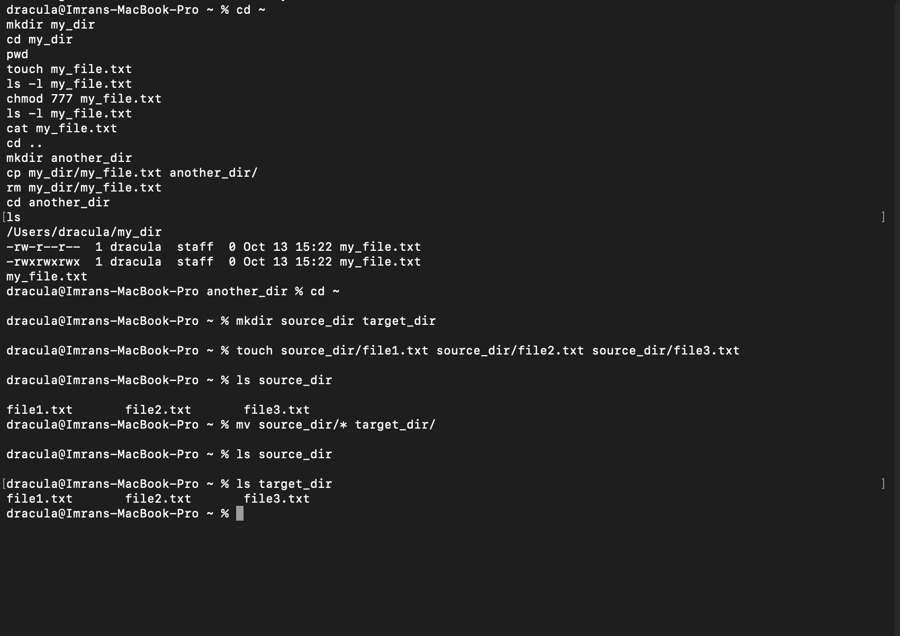
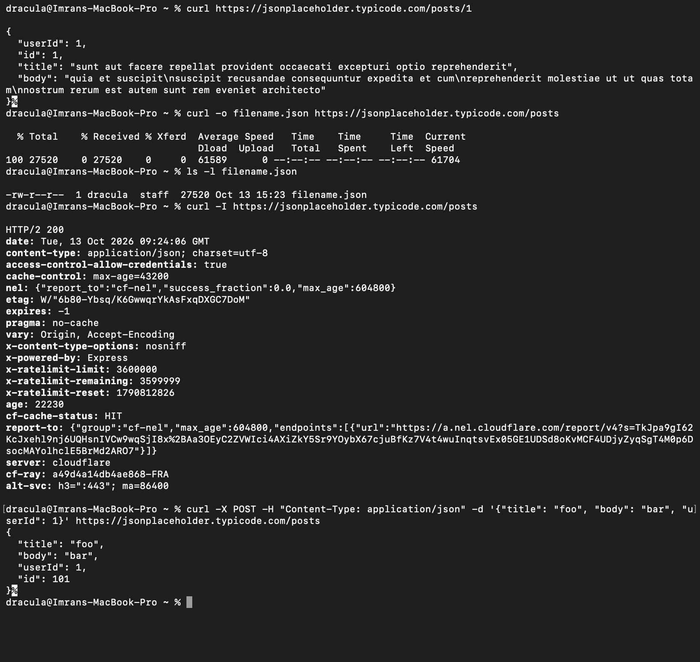
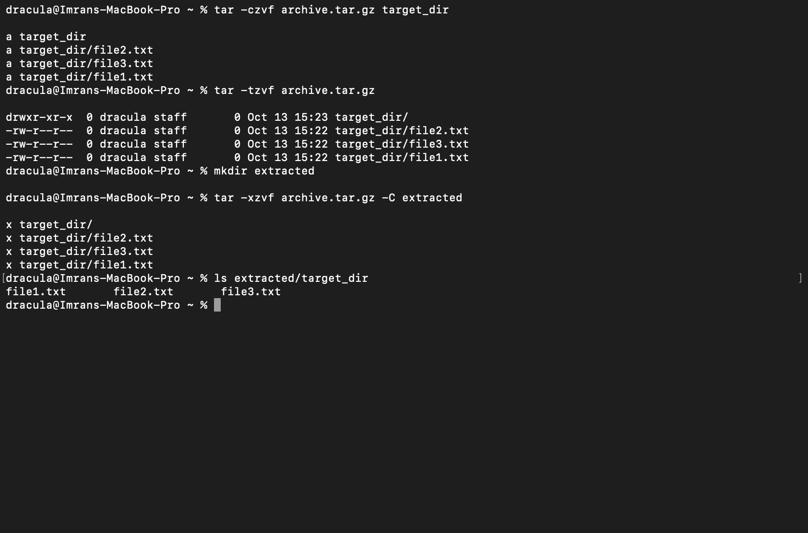

# Lab 1. Comprehending UNIX Terminal Commands

**Course:** COM-424.1 Information Security, AUCA
**Student:** Imran Sahak
**Environment:** macOS Terminal (zsh)

## Goal

Practice basic UNIX commands for working with directories and files, learn to find information about commands with `--help` and `man`, send HTTP requests with `curl`, and explore the `tar` command on my own.

> **macOS note:** The lab uses `cd /home`. On macOS `/home` is a system mount point, and you cannot create folders there. The home directory on macOS is `/Users/<username>`, so I used `cd ~` instead. All other commands work the same as on Linux.

---

## Part 1. Basic commands

### 1. Go to an existing directory and create a new directory

```bash
cd ~
mkdir my_dir
```

- `cd` (change directory) moves to another directory. `~` is the home directory.
- `mkdir` (make directory) creates a new directory.

### 2. Navigate to the new directory

```bash
cd my_dir
pwd
```

- `pwd` (print working directory) shows where I am now.

```
/Users/dracula/my_dir
```

### 3. Create a new .txt file

```bash
touch my_file.txt
```

- `touch` creates an empty file, or updates the timestamp of a file that already exists.

### 4. Grant all permissions to the file

```bash
ls -l my_file.txt      # before
chmod 777 my_file.txt
ls -l my_file.txt      # after
```

- `chmod` (change mode) changes file permissions.
- `777` = read (4) + write (2) + execute (1) = 7, for **owner**, **group** and **others**.

```
-rw-r--r--  1 dracula  staff  0 Oct 13 15:22 my_file.txt
-rwxrwxrwx  1 dracula  staff  0 Oct 13 15:22 my_file.txt
```

Before `chmod`, the file had the default `644` permissions (`rw-r--r--`). After `chmod 777`, every user has read, write and execute (`rwxrwxrwx`).

> **Security note:** `777` lets any user on the system read, change and execute the file. It is fine for this exercise but bad practice on real systems. A safer default for a text file is `chmod 644` (owner can read and write, everyone else can only read).

### 5. Read the file

```bash
cat my_file.txt
```

- `cat` prints the contents of a file. Nothing is printed because the file is empty.

### 6. Go back to the parent directory

```bash
cd ..
```

- `..` means the parent directory (one level up).

### 7. Create another new directory

```bash
mkdir another_dir
```

### 8. Copy the file to the new directory

```bash
cp my_dir/my_file.txt another_dir/
```

- `cp` (copy) copies a file. The original stays where it was.

### 9. Delete the original file

```bash
rm my_dir/my_file.txt
```

- `rm` (remove) deletes a file permanently. There is no Trash in the terminal.

### 10. Verify the file exists in the new directory

```bash
cd another_dir
ls
```

```
my_file.txt
```

The file was copied successfully before the original was deleted.

---

## Task 1. Create two directories and move all files instead of copying

```bash
cd ~
mkdir source_dir target_dir

# create a few files to move
touch source_dir/file1.txt source_dir/file2.txt source_dir/file3.txt
ls source_dir

# move all files at once
mv source_dir/* target_dir/

# check the result
ls source_dir      # now empty
ls target_dir      # file1.txt file2.txt file3.txt
```

- `mv` (move) moves files. Unlike `cp`, it removes them from the original location, so steps 8 and 9 (copy, then delete) become one command.
- `*` is a wildcard that matches every file in the directory.
- `mv` is also used to rename a file: `mv old_name.txt new_name.txt`.

**Output:**
```
% ls source_dir
file1.txt       file2.txt       file3.txt
% mv source_dir/* target_dir/
% ls source_dir
% ls target_dir
file1.txt       file2.txt       file3.txt
```

After `mv`, `source_dir` is empty and all three files are in `target_dir`, so they were moved, not copied.

---

## Part 2. Discovering Unix commands with `--help`

Most commands describe their options when run with `--help`:

```bash
curl --help
```

> **Note:** The lab document shows `curl –help` with a single long dash, which is a typo from the word processor. The correct option uses two normal hyphens: `--help`. On macOS, `curl --help` prints a short list of the most used options; `curl --help all` prints all of them. `man curl` gives the full manual.

`curl` is a tool for sending HTTP requests from the terminal. I used the free test API `jsonplaceholder.typicode.com`.

### 1. Basic GET request

```bash
curl https://jsonplaceholder.typicode.com/posts
```

This returns a JSON list of 100 posts, which fills the whole screen. To keep the output short, I requested a single post:

```bash
curl https://jsonplaceholder.typicode.com/posts/1
```

**Output:**
```json
{
  "userId": 1,
  "id": 1,
  "title": "sunt aut facere repellat provident occaecati excepturi optio reprehenderit",
  "body": "quia et suscipit\nsuscipit recusandae consequuntur expedita et cum\nreprehenderit molestiae ut ut quas totam\nnostrum rerum est autem sunt rem eveniet architecto"
}
```

> The `%` that zsh prints after the closing `}` is not part of the response. It means the output did not end with a newline.

### 2. Save output to a file

```bash
curl -o filename.json https://jsonplaceholder.typicode.com/posts
ls -l filename.json
```

- `-o <file>` (output) saves the response to a file instead of printing it. Instead of the data, curl shows a progress table.

**Output:**
```
  % Total    % Received % Xferd  Average Speed   Time    Time     Time  Current
                                 Dload  Upload   Total   Spent    Left  Speed
100 27520    0 27520    0     0  61589      0 --:--:-- --:--:-- --:--:-- 61704

-rw-r--r--  1 dracula  staff  27520 Oct 13 15:23 filename.json
```

The file `filename.json` (27,520 bytes) now contains all 100 posts.

### 3. Test API responses (headers only)

```bash
curl -I https://jsonplaceholder.typicode.com/posts
```

- `-I` sends a HEAD request and shows only the response headers, such as the status code (`HTTP/2 200`) and `content-type`.

**Output (main headers):**
```
HTTP/2 200
date: Tue, 13 Oct 2026 09:24:06 GMT
content-type: application/json; charset=utf-8
cache-control: max-age=43200
x-content-type-options: nosniff
x-powered-by: Express
x-ratelimit-limit: 3600000
x-ratelimit-remaining: 3599999
cf-cache-status: HIT
server: cloudflare
```

What the headers show:
- `HTTP/2 200`: the request succeeded (200 = OK).
- `content-type`: the response is JSON.
- `server: cloudflare` and `cf-cache-status: HIT`: the API is behind Cloudflare, and this response came from its cache.
- `x-powered-by: Express`: the backend runs on Express (Node.js). **Security note:** headers like this reveal the server technology to attackers, so production servers often remove them.
- `x-content-type-options: nosniff`: a security header that stops browsers from guessing the content type.
- `x-ratelimit-*`: how many requests are allowed and how many are left.

### 4. Create a new post (POST request)

```bash
curl -X POST -H "Content-Type: application/json" \
  -d '{"title": "foo", "body": "bar", "userId": 1}' \
  https://jsonplaceholder.typicode.com/posts
```

- `-X POST` sets the HTTP method.
- `-H` adds a header (here, that the body is JSON).
- `-d` sends data in the request body.
- `\` continues the command on the next line.

**Output:**
```json
{
  "title": "foo",
  "body": "bar",
  "userId": 1,
  "id": 101
}
```

The server answers with the created object and a new `id` of 101, because 100 posts already exist. The test API does not really save it.

---

## Task 2. Discovering the `tar` command

```bash
tar --help
man tar
```

`tar` (tape archive) packs many files and folders into one archive file, and can compress it. Main options:

| Option | Meaning |
|--------|---------|
| `-c` | create an archive |
| `-x` | extract an archive |
| `-t` | list the contents of an archive |
| `-v` | verbose: show each file being processed |
| `-f <file>` | archive file name (must be followed by the name) |
| `-z` | compress or decompress with gzip (`.tar.gz`) |
| `-C <dir>` | extract into a given directory |

Examples I tried:

```bash
cd ~

# create a compressed archive of target_dir
tar -czvf archive.tar.gz target_dir

# list what is inside without extracting
tar -tzvf archive.tar.gz

# extract into a new folder
mkdir extracted
tar -xzvf archive.tar.gz -C extracted
ls extracted/target_dir
```

**Output:**
```
% tar -czvf archive.tar.gz target_dir
a target_dir
a target_dir/file2.txt
a target_dir/file3.txt
a target_dir/file1.txt

% tar -tzvf archive.tar.gz
drwxr-xr-x  0 dracula staff       0 Oct 13 15:23 target_dir/
-rw-r--r--  0 dracula staff       0 Oct 13 15:22 target_dir/file2.txt
-rw-r--r--  0 dracula staff       0 Oct 13 15:22 target_dir/file3.txt
-rw-r--r--  0 dracula staff       0 Oct 13 15:22 target_dir/file1.txt

% tar -xzvf archive.tar.gz -C extracted
x target_dir/
x target_dir/file2.txt
x target_dir/file3.txt
x target_dir/file1.txt

% ls extracted/target_dir
file1.txt       file2.txt       file3.txt
```

- `a` = file **added** to the archive, `x` = file **extracted** from it.
- Listing with `-t` shows that the archive also stores permissions, owner and dates, so files keep their permissions when they are extracted.
- After extracting, all three files are in `extracted/target_dir`, so the archive works.

> **macOS note:** macOS uses BSD `tar` (bsdtar), while most Linux systems use GNU `tar`. The common options above are the same in both.

---

## Command summary

| Command | Purpose |
|---------|---------|
| `cd` | Change the current directory (`..` = parent, `~` = home) |
| `pwd` | Show the current directory |
| `mkdir` | Create a directory |
| `ls` / `ls -l` | List files / list with permissions, owner, size, date |
| `touch` | Create an empty file |
| `chmod` | Change file permissions |
| `cat` | Print file contents |
| `cp` | Copy files |
| `mv` | Move or rename files |
| `rm` | Delete files |
| `curl` | Send HTTP requests |
| `tar` | Create and extract archives |
| `--help` / `man` | Show help or the manual for a command |

## Screenshots

   
   
   
## Conclusion

In this lab I learned how to navigate the file system, create, copy, move and delete files and directories, and change file permissions. I used `curl` to send GET and POST requests to an API and read the response headers, and I learned to use `--help` and `man` to discover new commands such as `tar`. From a security point of view, I saw that permissions like `777` are dangerous, and that `rm` deletes files permanently.
