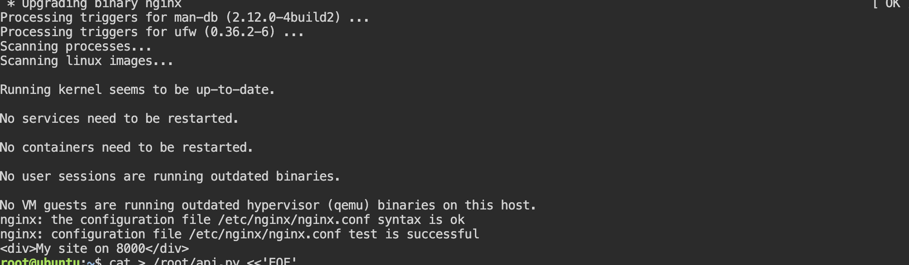
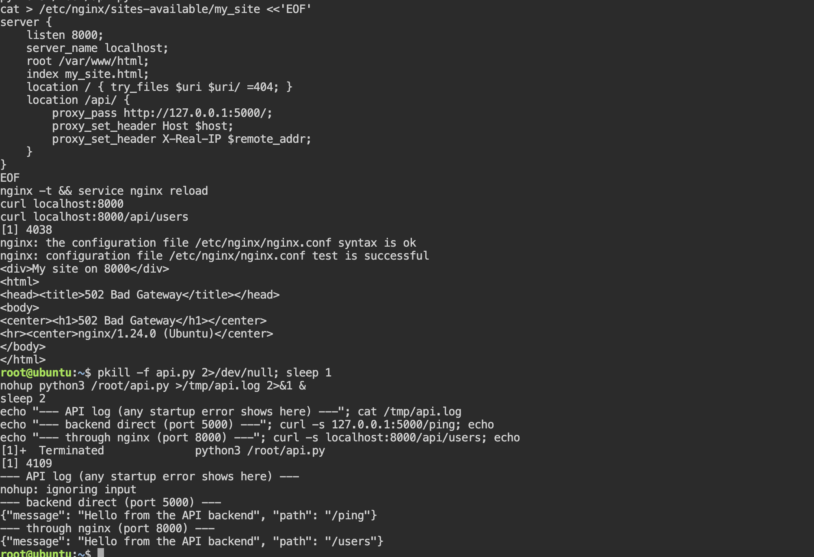

# Lab 10. Configuring NGINX

- **Course:** COM-424.1 Information Security, AUCA
- **Student:** Imran Sahak
- **Environment:** Linux (Ubuntu 24.04 playground / Kali VM), nginx 1.24.0

## Goal

Configure nginx as a web server that serves an HTML page on port 8000 using a
virtual host (server block), and (the task) use `proxy_pass` to forward requests to
a running backend API — nginx acting as a **reverse proxy**.

## What nginx is for

nginx is a high-performance web server and reverse proxy. Common uses: serving
static sites, reverse-proxying to app servers, load balancing, SSL/TLS termination,
caching and rate limiting.

### How nginx config is organized on Ubuntu

| Path | Purpose |
|------|---------|
| `/etc/nginx/nginx.conf` | main configuration |
| `/etc/nginx/sites-available/` | site configs you write (not active yet) |
| `/etc/nginx/sites-enabled/` | symlinks to the sites that are actually active |

Best practice: write a site config in `sites-available/`, then symlink it into
`sites-enabled/` to switch it on. This lets you enable/disable sites by
adding/removing a link instead of editing files.

> **Environment notes (for the Ubuntu playground / containers):**
> - If `systemctl` gives "System has not been booted with systemd", use
>   `service nginx start` / `service nginx reload`, or `nginx -s reload`.
> - If `nginx -t` fails with `socket() [::]:80 failed ... Address family not
>   supported` (an IPv6 issue in some containers), remove the default site:
>   `rm /etc/nginx/sites-enabled/default`, then re-test.

---

## Part 1. Serve a static page on port 8000

### 1. Install nginx

```bash
apt update
apt install -y nginx
```

### 2. Create the site config

`/etc/nginx/sites-available/my_site`:
```nginx
server {
    listen 8000;
    server_name localhost;
    root /var/www/html;      # where the HTML files live
    index my_site.html;      # default file to serve

    location / {
        try_files $uri $uri/ =404;   # serve the file, else return 404
    }
}
```

Create the HTML file it serves:
```bash
echo '<div>My site on 8000</div>' > /var/www/html/my_site.html
```

### 3. Enable the site (symlink into sites-enabled)

```bash
ln -s /etc/nginx/sites-available/my_site /etc/nginx/sites-enabled/
```

### 4. Test the config and reload

```bash
nginx -t              # check the config for syntax errors
service nginx reload  # (or: systemctl reload nginx / nginx -s reload)
```
**Output of `nginx -t`:**
```
nginx: the configuration file /etc/nginx/nginx.conf syntax is ok
nginx: configuration file /etc/nginx/nginx.conf test is successful
```

### 5. Check it works

In a browser: `http://localhost:8000`. In a terminal (works everywhere):
```bash
curl localhost:8000
```
**Output:**
```
<div>My site on 8000</div>
```

If something is wrong, check the log: `tail -f /var/log/nginx/error.log`.

---

## Part 2. Task — `proxy_pass` to a running API (reverse proxy)

`proxy_pass` makes nginx forward matching requests to another server. This is how
nginx is used as a **reverse proxy** in front of an application (Node.js, Flask,
etc.): the app runs on an internal port, and nginx is the public front door.

### a) Start a small backend API (for testing)

A tiny Python API that returns JSON, listening on port 5000:
```python
# api.py
from http.server import BaseHTTPRequestHandler, HTTPServer
import json

class H(BaseHTTPRequestHandler):
    def do_GET(self):
        self.send_response(200)
        self.send_header("Content-Type", "application/json")
        self.end_headers()
        self.wfile.write(json.dumps(
            {"message": "Hello from the API backend", "path": self.path}).encode())

HTTPServer(("127.0.0.1", 5000), H).serve_forever()
```
```bash
python3 api.py &      # run it in the background
```

### b) Add a proxy_pass location to the site

Add this `location` block inside the `server { ... }` in
`/etc/nginx/sites-available/my_site`:
```nginx
    location /api/ {
        proxy_pass http://127.0.0.1:5000/;
        proxy_set_header Host $host;
        proxy_set_header X-Real-IP $remote_addr;
    }
```
- `proxy_pass http://127.0.0.1:5000/;` forwards requests to the backend.
- The trailing `/` matters: `/api/users` is forwarded as `/users` (the `/api/`
  prefix is stripped). Without the trailing slash it would forward `/api/users`.
- `proxy_set_header` passes the original host and client IP to the backend, so the
  app can see who really made the request.

### c) Reload and test

```bash
nginx -t && service nginx reload
curl localhost:8000           # the static site, unchanged
curl localhost:8000/api/users # proxied to the backend on :5000
```
**Output:**
```
<div>My site on 8000</div>
{"message": "Hello from the API backend", "path": "/users"}
```
The second request went to nginx on port 8000, which forwarded it to the API on
port 5000 and returned its JSON — and the backend received `/users`, proving the
`/api/` prefix was rewritten.

---

## Security notes

- **A reverse proxy hides the backend.** The API listens only on `127.0.0.1`
  (localhost), so it is not reachable from outside directly — only through nginx.
  This is a standard hardening pattern: expose one front door and keep app servers
  off the public network.
- Because all traffic funnels through nginx, it is the right place to add **TLS
  (HTTPS), rate limiting, and access rules**, protecting every backend behind it at
  once.
- `nginx -t` **before** reloading is important: applying a broken config to a live
  server can take a site down. Always validate first.
- Passing `X-Real-IP` / `X-Forwarded-For` lets the backend log the true client IP;
  without it, every request would appear to come from the proxy itself.

## Conclusion

In this lab I configured nginx as a web server: I wrote a server block listening on
port 8000, enabled it with a symlink from `sites-available` to `sites-enabled`,
validated it with `nginx -t`, and served an HTML page (confirmed with
`curl localhost:8000`). For the task I used `proxy_pass` to turn nginx into a reverse
proxy: a request to `localhost:8000/api/` was forwarded to a backend API running on
port 5000, with the `/api/` prefix rewritten. I learned how nginx's site structure
works, why validating config before reload matters, and how a reverse proxy keeps
backend servers off the public network while centralizing TLS and access control.

## Screenshots

Configuring and serving the site on port 8000:



The `proxy_pass` task — forwarding `/api/` to the backend API:


