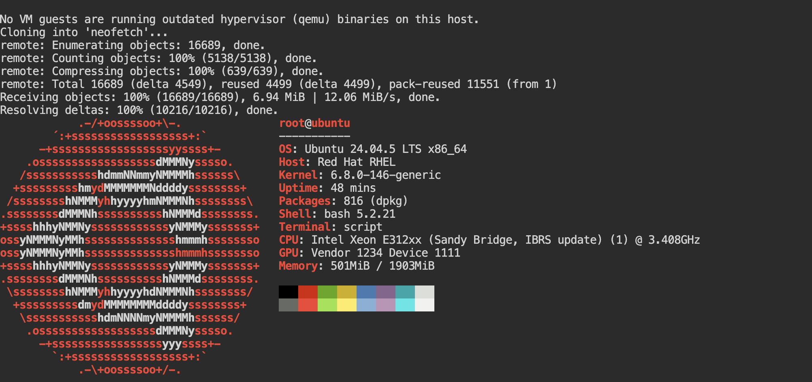
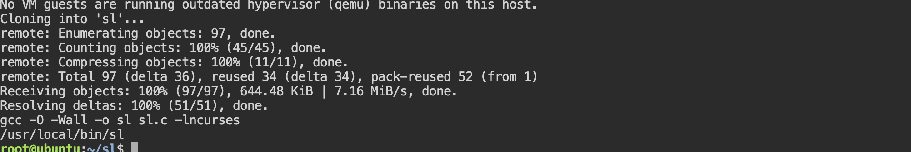

# Lab 11. Installing Packages from Source

- **Course:** COM-424.1 Information Security, AUCA
- **Student:** Imran Sahak
- **Environment:** Linux (Ubuntu 24.04 playground / Kali VM)

## Goal

Learn to install software by building it from source code instead of from APT, and
(the task) build a utility from a GitHub repository myself.

## Why install from source?

- **Latest version** — newest features/fixes may only be in the source.
- **Customization** — enable/disable features or install to a custom location.
- **Optimization** — compile tuned for your specific hardware.
- **No package available** — not everything ships as a `.deb`.

## The four common methods

| Method | Typical steps |
|--------|---------------|
| **Classic (`configure`/`make`)** | `./configure` → `make` → `sudo make install` |
| **CMake** | `mkdir build && cd build` → `cmake ..` → `make` → `sudo make install` |
| **Git-based** | `git clone <repo>` → build with make/cmake |
| **Install script** | run a provided `install.sh` / `setup.py` |

The general idea is always: **get the source → configure/compile → install** (copy
the result into a system directory on `$PATH`).

---

## Example 1: neofetch (git + make install)

neofetch is a Bash tool that prints a summary of the system. It is a simple script,
so "building" just copies it into place.

```bash
apt update
apt install -y git make
git clone https://github.com/dylanaraps/neofetch.git
cd neofetch
make install        # copies the script to /usr/bin (a $PATH directory)
neofetch            # run it
```
**Output:**
```
root@ubuntu
----------
OS: Ubuntu 24.04.5 LTS x86_64
Kernel: 6.x.x
Uptime: 8 mins
Packages: 1026 (dpkg)
Shell: bash 5.2.21
CPU: Intel Xeon (2) @ 2.80GHz
Memory: 731MiB / 8027MiB
```
`make install` here reads the repo's `Makefile`, which copies `neofetch` into
`/usr/bin` so it can be run from anywhere.

## Example 2: youtube-dl (git + setup.py)

The lab's other example installs a Python tool from source:
```bash
apt install -y python3 python3-pip python3-setuptools
git clone https://github.com/ytdl-org/youtube-dl.git
cd youtube-dl
sudo python3 setup.py install
youtube-dl --version
```
`setup.py` is Python's build/install script; `install` copies the package into the
Python environment. (On very recent systems `setup.py install` is deprecated in
favour of `pip install .`, so `pip install .` from inside the repo is the modern
equivalent.)

---

## Task — build a utility from source myself

For the task I built **`sl`** ("steam locomotive"), a small program written in C.
Unlike neofetch (a script), this one is **compiled from C source with gcc**, so it
shows the real compile step of the classic method.

```bash
# dependencies: a C compiler, make, and the ncurses library sl uses
apt install -y git make gcc libncurses-dev

# get the source
git clone https://github.com/mtoyoda/sl.git
cd sl

# compile it (make runs gcc)
make

# install: copy the compiled binary into a $PATH directory
sudo cp sl /usr/local/bin/

# run it
sl
```
**Output of `make`:**
```
gcc -O -Wall -o sl sl.c -lncurses
```
This single line is the compiler turning the C source `sl.c` into the executable
`sl`, linking against the ncurses library (`-lncurses`) for the terminal animation.
After `cp sl /usr/local/bin/`, the command runs from anywhere:
```bash
which sl        # /usr/local/bin/sl
sl              # a steam train animates across the terminal
```

The important part is the pattern, which is the same for any C/C++ project:
**clone → `make` (compile) → copy the binary onto `$PATH`.**

---

## Security notes

- **Building from source means running code you downloaded.** A `./configure`,
  `make`, or `install.sh` script executes with your privileges and can do anything —
  so source should only be built from projects you trust. `sudo make install` is
  especially risky because it runs as root.
- Unlike APT, source builds have **no signature verification**. APT checks packages
  against repository GPG keys; a random GitHub repo has no such guarantee, so verify
  the project's authenticity (stars, official URL, release signatures) first.
- Software installed from source is **not tracked by the package manager**, so it
  does not get security updates from `apt upgrade`. You are responsible for updating
  it yourself (re-pull and rebuild), which is a real maintenance and security burden.
- Prefer the distro package when one exists; build from source only when you must.

## Conclusion

In this lab I learned the four ways to install software from source — the classic
`./configure && make && make install`, CMake, cloning from Git, and install scripts
— and that they all follow the same get-source → compile → install pattern. I
installed neofetch (a Bash script, copied into place by `make install`) and, for the
task, compiled `sl` from C source with gcc and installed the binary to
`/usr/local/bin`. I also learned the security trade-offs: source builds run
untrusted code, have no signature checking, and aren't updated by the package
manager, so APT is preferable whenever a package exists.

## Screenshots

Installing neofetch from source and running it:



The task — compiling `sl` from C source and running it:


