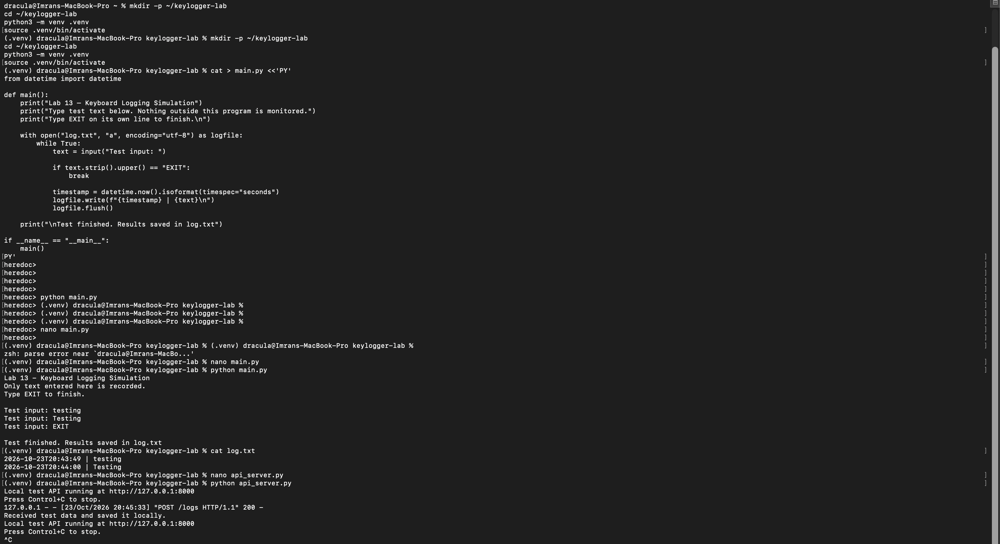
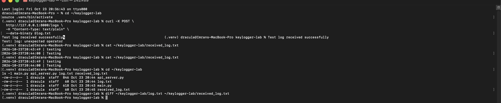

# Lab 13. Keyloggers

- **Course:** COM-424.1 Information Security, AUCA
- **Student:** Imran Sahak
- **Environment:** Linux (controlled test environment)

> **Scope & ethics.** A keylogger records a person's keystrokes, often without their
> knowledge, and is classed as **malware** when used to capture someone's input
> covertly. Any observation in this lab was done only against **my own test input on
> a machine I control**, to understand the threat. Installing or running a keylogger
> on a device without the informed consent of its user is illegal (unauthorized
> interception/computer-misuse laws) and a violation of university policy. The focus
> of this report is understanding the threat so it can be **detected and defended
> against** — see those sections below.

## Goal

Understand how keystroke logging works, the forms it takes, how it is delivered, and
— most importantly — how it is **detected and prevented**.

## What a keylogger is

Keylogging (keystroke logging) is the recording or monitoring of a user's keyboard
input. The captured text can be stored locally or transmitted to a remote party.
Because almost everything sensitive is typed at some point — passwords, card numbers,
messages — keystrokes are an extremely high-value target, which is why keyloggers are
a common component of real-world malware.

## Types of keylogger

| Type | How it works | Notes |
|------|--------------|-------|
| **Software – application level** | records input while a specific app has focus | easiest to write, easiest to detect |
| **Software – OS / API level** | subscribes to the operating system's global keyboard events | captures input across all apps; this is the most common form |
| **Software – kernel level** | runs as a driver below the OS input stack | hard to detect, needs high privilege to install |
| **Hardware** | a physical device between keyboard and computer, or inside the keyboard | invisible to software/antivirus; requires physical access |

A key security point: at the software level, keyloggers are **easy to build**, because
operating systems expose legitimate input-event interfaces (used by accessibility
tools, games, and automation). The same interface that lets a screen reader see what
you type lets malware see it too — which is exactly why the **defences** below matter.

## How keyloggers are delivered

Keyloggers rarely arrive labelled as such. Common delivery routes:

- **Phishing** — a malicious attachment or link installs it (ties directly to Lab 4).
- **Trojanized software** — bundled inside a cracked app, fake installer, or browser
  extension.
- **Drive-by downloads** — from a compromised or malicious website.
- **Physical access** — a hardware keylogger plugged in by someone with brief access
  to the machine.

## Legitimate vs malicious uses

| Legitimate (with consent / authority) | Malicious |
|----------------------------------------|-----------|
| Employee monitoring on company devices (where disclosed and lawful) | Stealing passwords, card numbers, identities |
| Parental-control / child-safety tools | Corporate or state espionage |
| Authorized security research / red-team testing | Account takeover, blackmail |

The dividing line is **consent and authorization**, not the technology itself.

## The practical exercise

Rather than build a real keylogger (which captures *all* of a user's keystrokes
covertly — malware), I implemented a **safe simulation** that demonstrates the same
concepts without the harmful capability. The difference is important:

| A real keylogger | This simulation |
|------------------|-----------------|
| hooks **global** keyboard events via the OS | only reads text typed **into its own prompt** |
| captures input from every app, silently | captures nothing outside the program, and announces itself |
| hides from the user | prints "Nothing outside this program is monitored" |

This still demonstrates the full chain a real keylogger uses — **capture → timestamp
→ store to a log file → transmit to a server** — but only on my own deliberate test
input, so it is a teaching model, not spyware.

### Setup

```bash
mkdir -p ~/keylogger-lab && cd ~/keylogger-lab
python3 -m venv .venv
source .venv/bin/activate
```

### `main.py` — the logging simulation

```python
from datetime import datetime

def main():
    print("Lab 13 - Keyboard Logging Simulation")
    print("Type test text below. Nothing outside this program is monitored.")
    print("Type EXIT on its own line to finish.\n")

    with open("log.txt", "a", encoding="utf-8") as logfile:
        while True:
            text = input("Test input: ")
            if text.strip().upper() == "EXIT":
                break
            timestamp = datetime.now().isoformat(timespec="seconds")
            logfile.write(f"{timestamp} | {text}\n")
            logfile.flush()

    print("\nTest finished. Results saved in log.txt")

if __name__ == "__main__":
    main()
```
It reads text I type at the `Test input:` prompt, timestamps each line, and appends
it to `log.txt` until I type `EXIT`. It uses `input()` — not a global keyboard hook —
so it can only ever see what I deliberately give it.

**Run and result:**
```
Test input: testing
Test input: Testing
Test input: EXIT

Test finished. Results saved in log.txt

$ cat log.txt
2026-10-23T20:43:49 | testing
2026-10-23T20:44:00 | Testing
```



### `api_server.py` — the "exfiltration" step (local test server)

A small local HTTP server listening on `127.0.0.1:8000` with a `/logs` endpoint that
receives a posted log and saves it (`received_log.txt`). This models the step where a
real keylogger would send its log to an attacker's server — but here both ends are on
my own machine. Sending the log and comparing the two files shows the transfer was
exact:
```
$ curl -X POST http://127.0.0.1:8000/logs -H "Content-Type: text/plain" --data-binary @log.txt
Test log received successfully
$ diff ~/keylogger-lab/log.txt ~/keylogger-lab/received_log.txt
$            # (no output = the received copy is identical)
```



## Detection — how to tell if a keylogger is present

| Signal | How to check (Linux examples) |
|--------|-------------------------------|
| Unknown running processes | `ps aux`, `top` / `htop` — look for unfamiliar long-running processes |
| Suspicious autostart entries | `~/.config/autostart`, `systemctl --user list-units`, cron jobs (`crontab -l`) |
| Outbound network connections | `ss -tupn` / `netstat` — a keylogger often "phones home" |
| Recently modified/odd files | unexpected `.log`/`.txt` files growing over time |
| Antivirus / EDR alerts | behavioral detection flags input-hooking + exfiltration |
| Hardware | physically inspect the keyboard cable/USB ports for unknown dongles |

## Defences

| Defence | Why it helps |
|---------|--------------|
| **Multi-factor authentication (MFA)** | a stolen typed password alone is useless without the second factor — the single most effective mitigation |
| **Password managers (autofill)** | credentials are pasted/filled, not typed, so a keystroke logger never sees them |
| **On-screen / virtual keyboards** | defeat simple keystroke-only loggers (though not screen-capturing malware) |
| **Don't install untrusted software** | most software keyloggers arrive bundled with something the user installed |
| **Least privilege** | kernel-level keyloggers need admin/root to install; not running as admin raises the bar |
| **Updated anti-malware / EDR** | detects known keyloggers and input-hooking behavior |
| **Physical security** | locked machines and inspected ports stop hardware keyloggers |
| **OS protections** | modern OSes restrict global input monitoring and require explicit permission (e.g. macOS Input Monitoring, Wayland's tighter input isolation on Linux) |

## Conclusion

In this lab I studied keystroke logging: what it is, the software (application-, OS-,
and kernel-level) and hardware forms it takes, and how it is delivered through
phishing, trojanized software, and physical access. Instead of building real spyware,
I implemented a **safe simulation** that demonstrates the capture → timestamp → store
→ transmit chain using only my own deliberate test input (via `input()`, not a global
keyboard hook) and a local test server, then verified the transferred log matched the
original. The central lessons are defensive: keyloggers are easy to build because the OS exposes
legitimate input interfaces, so protection comes from **MFA** (which neutralizes a
stolen password), **password-manager autofill** (so secrets are never typed),
avoiding untrusted software, least-privilege, anti-malware, physical security, and
OS-level input restrictions. Keylogging is only lawful with the informed consent of
the person being monitored.
