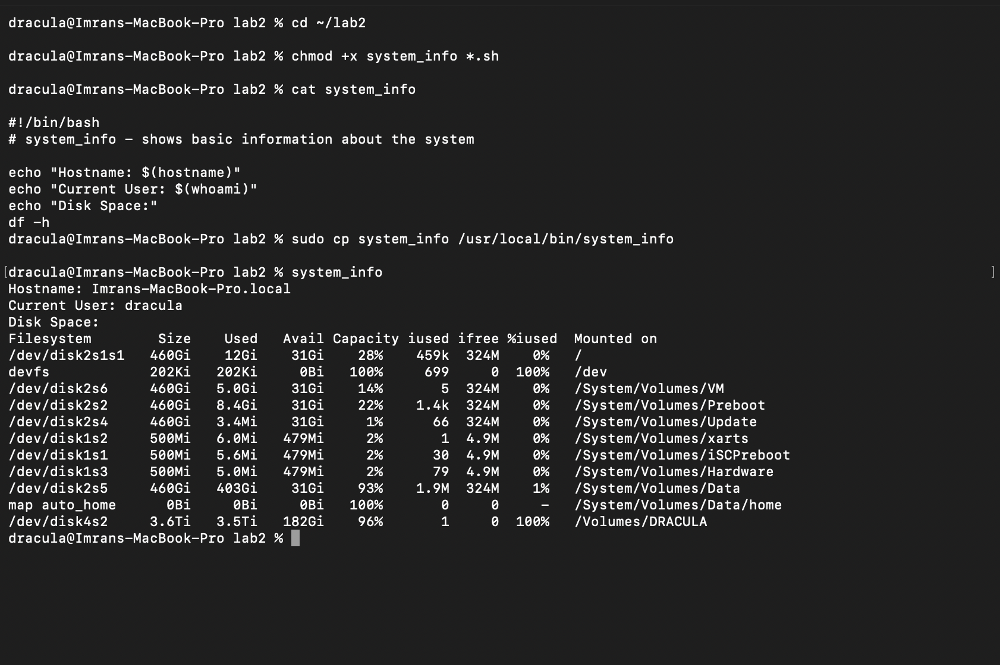
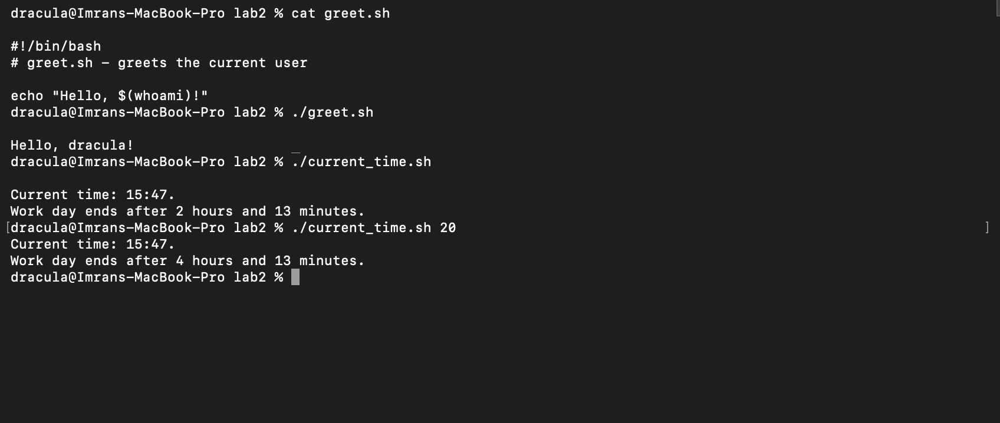
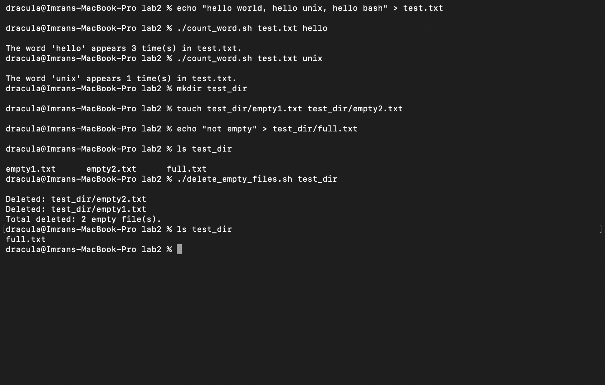

# Lab 2. Custom UNIX-based Commands

- **Course:** COM-424.1 Information Security, AUCA
- **Student:** Imran Sahak
- **Environment:** macOS Terminal (zsh), scripts run with `/bin/bash`

## Goal

Create custom terminal commands and shell scripts that automate tasks by combining existing UNIX commands.

## Files

| File | Description |
|------|-------------|
| [`system_info`](system_info) | Custom command: shows hostname, current user and disk space |
| [`greet.sh`](greet.sh) | Greets the current user |
| [`current_time.sh`](current_time.sh) | Shows the current time and time left until the work day ends |
| [`count_word.sh`](count_word.sh) | Counts how many times a word appears in a file |
| [`delete_empty_files.sh`](delete_empty_files.sh) | Finds and deletes empty files in a directory |

---

## Part 1. Custom command `system_info`

### 1. Create the file

```bash
#!/bin/bash
# system_info - shows basic information about the system

echo "Hostname: $(hostname)"
echo "Current User: $(whoami)"
echo "Disk Space:"
df -h
```

- `#!/bin/bash` (the *shebang*) tells the system to run the file with bash.
- `$(command)` runs a command and inserts its output into the text.
- `hostname` prints the computer name, `whoami` prints the current user, and `df -h` shows disk usage in human-readable units (Gi, Mi).

> I printed `df -h` on its own line instead of `echo "Disk Space: $(df -h)"` as in the lab. The output is the same, but this way the table starts on a new line and its columns stay aligned.

### 2. Make it executable and install it

```bash
chmod +x system_info
sudo cp system_info /usr/local/bin/system_info
```

- `chmod +x` adds the execute permission, so the file can run as a program.
- `/usr/local/bin` is one of the directories in `$PATH`, the list of folders where the shell looks for commands. A script placed there can be run **by name from any directory**, like a built-in command.
- `sudo` is needed because `/usr/local/bin` belongs to the system, not to the user.

> **macOS note:** On macOS, Terminal cannot read files in `~/Documents`, `~/Downloads` or `~/Desktop` until it is given permission in *System Settings → Privacy & Security → Files & Folders*. Running the scripts there gave `Operation not permitted`, so I kept the lab in `~/lab2`.

### 3. Test it

```bash
system_info
```

**Output:**
```
Hostname: Imrans-MacBook-Pro.local
Current User: dracula
Disk Space:
Filesystem        Size    Used   Avail Capacity iused ifree %iused  Mounted on
/dev/disk2s1s1   460Gi    12Gi    31Gi    28%    459k  324M    0%   /
devfs            202Ki   202Ki     0Bi   100%     699     0  100%   /dev
/dev/disk2s6     460Gi   5.0Gi    31Gi    14%       5  324M    0%   /System/Volumes/VM
/dev/disk2s2     460Gi   8.4Gi    31Gi    22%    1.4k  324M    0%   /System/Volumes/Preboot
/dev/disk2s5     460Gi   403Gi    31Gi    93%    1.9M  324M    1%   /System/Volumes/Data
...
```



> **Security note:** Anything in `/usr/local/bin` runs for every user who types its name. If an attacker can write to a directory in `$PATH`, they can replace a common command with a malicious one. This is why such directories are owned by root and need `sudo` to change.

---

## Part 2. Study projects

### 1. `greet.sh`: display a greeting

```bash
#!/bin/bash
# greet.sh - greets the current user

echo "Hello, $(whoami)!"
```

**Output:**
```
% ./greet.sh
Hello, dracula!
```

### 2. `current_time.sh`: time remaining before the work day ends

```bash
#!/bin/bash
# current_time.sh - shows the current time and how long until the work day ends
# Usage: ./current_time.sh [end_hour]    (default end hour: 18, i.e. 18:00)

END_HOUR=${1:-18}

HOUR=$(date +%H)
MINUTE=$(date +%M)

# 10# forces base 10, so "08" and "09" are not read as octal numbers
NOW=$(( 10#$HOUR * 60 + 10#$MINUTE ))
END=$(( END_HOUR * 60 ))
LEFT=$(( END - NOW ))

echo "Current time: $HOUR:$MINUTE."

if [ "$LEFT" -le 0 ]; then
    echo "The work day is over. Go home!"
else
    echo "Work day ends after $(( LEFT / 60 )) hours and $(( LEFT % 60 )) minutes."
fi
```

How it works:
- `date +%H` and `date +%M` give the current hour and minute.
- Both times are converted to minutes since midnight, and the difference is the time left.
- `LEFT / 60` gives the hours and `LEFT % 60` (remainder) gives the minutes.
- `${1:-18}` uses the first argument as the end hour, or 18 if none is given.
- `10#` is needed because bash reads numbers with a leading zero, like `08`, as octal, and `08` is not a valid octal number.

**Output:**
```
% ./current_time.sh
Current time: 15:47.
Work day ends after 2 hours and 13 minutes.

% ./current_time.sh 20
Current time: 15:47.
Work day ends after 4 hours and 13 minutes.
```



### 3. `count_word.sh`: count word occurrences in a file

```bash
#!/bin/bash
# count_word.sh - counts how many times a word appears in a file
# Usage: ./count_word.sh <file> <word>

if [ $# -ne 2 ]; then
    echo "Usage: $0 <file> <word>"
    exit 1
fi

FILE=$1
WORD=$2

if [ ! -f "$FILE" ]; then
    echo "Error: file '$FILE' not found."
    exit 1
fi

# -o prints every match on its own line, -w matches whole words only,
# then wc -l counts the lines (= number of matches)
COUNT=$(grep -o -w -- "$WORD" "$FILE" | wc -l | tr -d ' ')

echo "The word '$WORD' appears $COUNT time(s) in $FILE."
```

How it works:
- `$#` is the number of arguments. If it is not 2, the script prints how to use it and exits.
- `-f` checks that the file exists.
- `grep -o -w` prints every whole-word match on a separate line, so `hello` does not match `shello` or `helloo`. `wc -l` counts those lines.
- Plain `grep -c` would be wrong here: it counts **lines** that contain the word, not the number of times the word appears.

**Output:**
```
% echo "hello world, hello unix, hello bash" > test.txt
% ./count_word.sh test.txt hello
The word 'hello' appears 3 time(s) in test.txt.
% ./count_word.sh test.txt unix
The word 'unix' appears 1 time(s) in test.txt.
```

All three `hello`s are on the same line, so `grep -c` would have returned 1, while this script correctly returns 3.

### 4. `delete_empty_files.sh`: find and delete empty files

```bash
#!/bin/bash
# delete_empty_files.sh - finds and deletes all empty files in a directory
# Usage: ./delete_empty_files.sh <directory>

if [ $# -ne 1 ]; then
    echo "Usage: $0 <directory>"
    exit 1
fi

DIR=$1

if [ ! -d "$DIR" ]; then
    echo "Error: directory '$DIR' not found."
    exit 1
fi

COUNT=0
# -type f = files only, -empty = size 0, -maxdepth 1 = do not go into subfolders
while IFS= read -r FILE; do
    rm "$FILE"
    echo "Deleted: $FILE"
    COUNT=$((COUNT + 1))
done < <(find "$DIR" -maxdepth 1 -type f -empty)

echo "Total deleted: $COUNT empty file(s)."
```

How it works:
- `-d` checks that the argument is a directory.
- `find -type f -empty` lists only regular files with size 0. `-maxdepth 1` limits the search to the given directory, not its subfolders, so the script never deletes more than expected.
- `while read -r` reads the file names one per line, which also works for names that contain spaces.
- Each file is deleted with `rm`, its name is printed, and the total is counted.

**Output:**
```
% mkdir test_dir
% touch test_dir/empty1.txt test_dir/empty2.txt
% echo "not empty" > test_dir/full.txt
% ls test_dir
empty1.txt      empty2.txt      full.txt
% ./delete_empty_files.sh test_dir
Deleted: test_dir/empty2.txt
Deleted: test_dir/empty1.txt
Total deleted: 2 empty file(s).
% ls test_dir
full.txt
```

Only the two empty files were deleted, and `full.txt` stayed.



> **Security note:** Scripts that delete files should check their input carefully. This script stops if the argument is missing or is not a directory, and it does not go into subfolders. Without these checks, a mistake in the argument could delete files in the wrong place.

---

## Commands used

| Command | Purpose |
|---------|---------|
| `echo` | Print text |
| `hostname` | Print the computer name |
| `whoami` | Print the current user name |
| `df -h` | Show disk space |
| `date +%H` / `date +%M` | Print the current hour / minute |
| `grep -o -w` | Find whole-word matches, one per line |
| `wc -l` | Count lines |
| `find -type f -empty` | Find empty files |
| `rm` | Delete files |
| `chmod +x` | Make a file executable |
| `sudo` | Run a command as administrator |

## Conclusion

In this lab I created a custom command and installed it in `/usr/local/bin` so it runs from any directory, and I wrote four shell scripts that use variables, arguments, `if` checks, loops and arithmetic. I learned how `$PATH` decides which commands can be run by name, why scripts need execute permission, and why scripts that delete files should validate their input. From a security point of view, I saw that system directories in `$PATH` are protected by `sudo`, and that macOS restricts Terminal's access to private folders like Documents.
