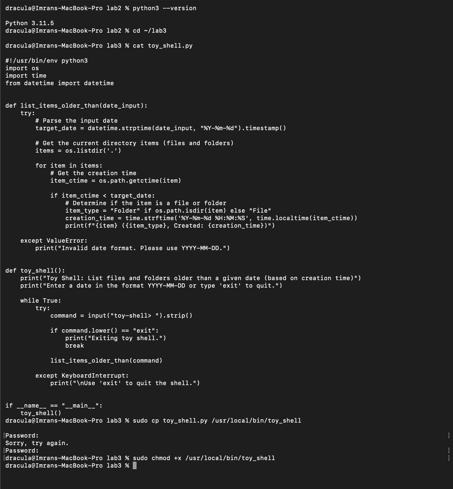
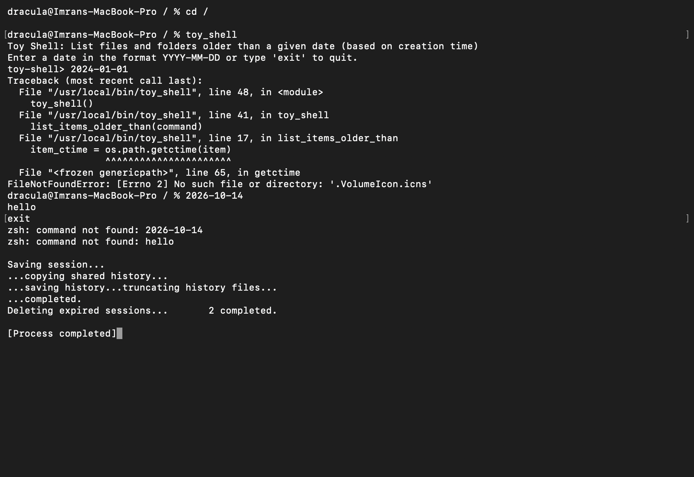
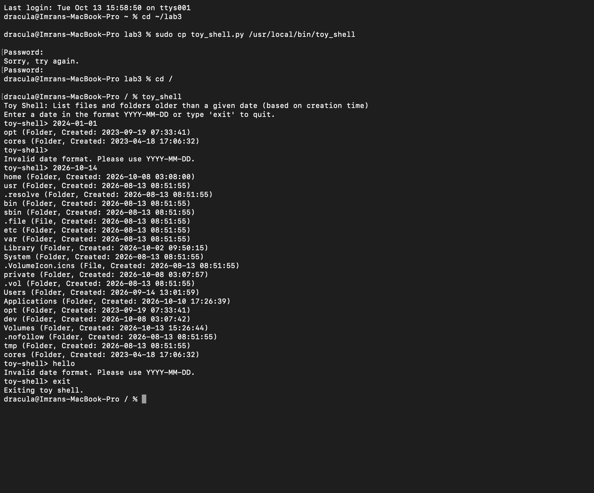

# Lab 3. Toy Shell

- **Course:** COM-424.1 Information Security, AUCA
- **Student:** Imran Sahak
- **Environment:** macOS Terminal (zsh), Python 3.11.5

## Goal

Build a *toy shell*: a small interactive command-line program written in Python. It reads a date in the format `YYYY-MM-DD` and lists the files and folders in the current directory that are older than that date. Then install it as a command that runs from any directory.

## What is a toy shell?

A real shell such as bash or zsh reads a command, interprets it, runs it and waits for the next one. This loop is called a **REPL** (Read, Evaluate, Print, Loop). A toy shell uses the same loop but understands only a few commands, which makes it useful for learning how shells work. This one understands two kinds of input:

| Input | Action |
|-------|--------|
| a date, e.g. `2024-01-01` | list items in the current directory older than this date |
| `exit` | quit the shell |

## Files

| File | Description |
|------|-------------|
| [`toy_shell.py`](toy_shell.py) | The toy shell, with my fix for the crash described below |

---

## 1. The script

```python
#!/usr/bin/env python3
import os
import time
from datetime import datetime


def list_items_older_than(date_input):
    try:
        # Parse the input date
        target_date = datetime.strptime(date_input, "%Y-%m-%d").timestamp()

        # Get the current directory items (files and folders)
        items = os.listdir('.')

        for item in items:
            # Get the creation time.
            # os.lstat() reads the item itself, so a broken symlink does not crash it.
            # A file we cannot read is skipped instead of crashing the whole shell.
            try:
                item_ctime = os.lstat(item).st_ctime
            except OSError as error:
                print(f"{item} (skipped: {error.strerror})")
                continue

            if item_ctime < target_date:
                # Determine if the item is a file or folder
                item_type = "Folder" if os.path.isdir(item) else "File"
                creation_time = time.strftime('%Y-%m-%d %H:%M:%S', time.localtime(item_ctime))
                print(f"{item} ({item_type}, Created: {creation_time})")

    except ValueError:
        print("Invalid date format. Please use YYYY-MM-DD.")


def toy_shell():
    print("Toy Shell: List files and folders older than a given date (based on creation time)")
    print("Enter a date in the format YYYY-MM-DD or type 'exit' to quit.")

    while True:
        try:
            command = input("toy-shell> ").strip()

            if command.lower() == "exit":
                print("Exiting toy shell.")
                break

            list_items_older_than(command)

        except KeyboardInterrupt:
            print("\nUse 'exit' to quit the shell.")
        except EOFError:
            # Ctrl+D closes the input, so quit cleanly
            print("\nExiting toy shell.")
            break


if __name__ == "__main__":
    toy_shell()
```

### How it works

- `#!/usr/bin/env python3` (the *shebang*) tells the system to run the file with Python 3. `env` finds `python3` in `$PATH`, so the script works wherever Python is installed.
- **`toy_shell()`** is the REPL. `while True` repeats forever, `input("toy-shell> ")` shows the prompt and reads a line, and `.strip()` removes extra spaces. `exit` ends the loop with `break`; any other input goes to `list_items_older_than()`.
- **`list_items_older_than()`**:
  - `datetime.strptime(date_input, "%Y-%m-%d")` turns the text into a date. If the text is not a valid date, it raises `ValueError`, which prints *Invalid date format*.
  - `.timestamp()` converts the date to seconds since 1 January 1970 (Unix time), so it can be compared with file times.
  - `os.listdir('.')` lists everything in the current directory, including hidden items that start with `.`.
  - Every item's time is compared with the target date, and older items are printed with their type and time.
- `except KeyboardInterrupt` catches **Ctrl+C**, so it prints a hint instead of quitting.
- `if __name__ == "__main__"` runs the shell only when the file is executed directly, not when it is imported by another script.

---

## 2. Installing it as a command

```bash
python3 --version
cd ~/lab3
sudo cp toy_shell.py /usr/local/bin/toy_shell
sudo chmod +x /usr/local/bin/toy_shell
```

- `/usr/local/bin` is in `$PATH`, so `toy_shell` can be run by name from any directory, just like `system_info` in Lab 2.
- I named it `toy_shell` without `.py`, so it looks like a normal command. The shebang line, not the file extension, decides how the file is run.
- I used `cp` instead of the lab's `mv`, so the original `toy_shell.py` stays in my lab folder and can be uploaded here.
- `chmod +x` makes it executable, and `sudo` is needed because `/usr/local/bin` belongs to the system.



---

## 3. Bug found: the shell crashed on a broken symlink

With the original code from the lab, I ran `toy_shell` in the root directory `/` and entered `2024-01-01`. The shell **crashed**:

```
toy-shell> 2024-01-01
Traceback (most recent call last):
  File "/usr/local/bin/toy_shell", line 17, in list_items_older_than
    item_ctime = os.path.getctime(item)
  ...
FileNotFoundError: [Errno 2] No such file or directory: '.VolumeIcon.icns'
```



**Why it happened:**
- `/.VolumeIcon.icns` on macOS is a **symbolic link** (a shortcut) that points to a file that does not exist, a so-called *broken symlink*.
- `os.path.getctime()` **follows** symlinks, so it tried to read the missing target file and raised `FileNotFoundError`.
- The original code only catches `ValueError` (a wrong date), so this error was not handled and the whole program stopped.
- Because the toy shell had stopped, the next lines I typed (`2026-10-14`, `hello`, `exit`) went to zsh instead. zsh did not know these commands, and `exit` closed the Terminal session.

**The fix:**
1. `os.lstat(item).st_ctime` instead of `os.path.getctime(item)`. `lstat` reads the information of the link **itself** instead of following it, so a broken link no longer causes an error.
2. A `try / except OSError` **around each item**. If one file still cannot be read, for example because of missing permissions, it is skipped with a message, and the shell keeps working.
3. `except EOFError` so that **Ctrl+D** quits cleanly instead of crashing.

> **Security note:** An unhandled error that crashes a program is a *denial of service*: one unusual file was enough to stop the tool. Programs that read directories they do not control must expect broken links, missing permissions and files that disappear while they are reading. Following symlinks without checking can also be dangerous: an attacker can create a symlink that points to a sensitive file, and a program that follows links blindly may read or overwrite that file (a *symlink attack*). Using `lstat` and handling errors for each item makes the tool more robust.

---

## 4. Testing it from another directory

```bash
cd /
toy_shell
```

**Output:**
```
Toy Shell: List files and folders older than a given date (based on creation time)
Enter a date in the format YYYY-MM-DD or type 'exit' to quit.
toy-shell> 2024-01-01
opt (Folder, Created: 2023-09-19 07:33:41)
cores (Folder, Created: 2023-04-18 17:06:32)
toy-shell>
Invalid date format. Please use YYYY-MM-DD.
toy-shell> 2026-10-14
home (Folder, Created: 2026-10-08 03:08:00)
usr (Folder, Created: 2026-08-13 08:51:55)
bin (Folder, Created: 2026-08-13 08:51:55)
etc (Folder, Created: 2026-08-13 08:51:55)
Library (Folder, Created: 2026-10-02 09:50:15)
System (Folder, Created: 2026-08-13 08:51:55)
.VolumeIcon.icns (File, Created: 2026-08-13 08:51:55)
Users (Folder, Created: 2026-09-14 13:01:59)
Applications (Folder, Created: 2026-10-10 17:26:39)
opt (Folder, Created: 2023-09-19 07:33:41)
Volumes (Folder, Created: 2026-10-13 15:26:44)
cores (Folder, Created: 2023-04-18 17:06:32)
...
toy-shell> hello
Invalid date format. Please use YYYY-MM-DD.
toy-shell> exit
Exiting toy shell.
```

- `2024-01-01`: only 2 items are older than this date.
- An empty line and `hello` are both rejected as invalid dates.
- `2026-10-14` (tomorrow): every item is listed, including hidden ones such as `.VolumeIcon.icns`, which is now listed instead of crashing the shell.
- `exit` quits the toy shell and returns to zsh.



---

## 5. Observation: `ctime` is not the creation time

The script says *"Created"*, but `st_ctime` on Linux and macOS means **change time**: the last time the file's *metadata* changed (permissions, owner, name, links). It is **not** the creation time. Only on Windows does `ctime` mean creation time.

My output proves this: `bin`, `etc`, `usr` and `System` are part of macOS and are years old, but they show `2026-08-13 08:51:55`, which is when macOS was last updated and the system files were rewritten.

The three standard UNIX timestamps are:

| Time | Meaning | Python |
|------|---------|--------|
| `atime` | last **access** (read) | `st_atime` |
| `mtime` | last **modification** of the content | `st_mtime` |
| `ctime` | last **change** of metadata | `st_ctime` |

macOS also stores the real creation time as `st_birthtime`, but this field is not available on every Linux system. For this lab I kept `ctime`, as in the original task.

> **Security note:** File timestamps are important in forensics, for example when investigating which files an attacker touched. They are not fully reliable: `touch -t` can set `atime` and `mtime` to any date, a technique called *timestomping*. `ctime` cannot be set directly by a normal user and changes whenever metadata changes, so investigators often trust it more than `mtime`.

---

## Conclusion

In this lab I wrote a toy shell in Python that uses a read-evaluate-print loop, parses dates, and compares them with file timestamps. I installed it in `/usr/local/bin` so it runs as a command from any directory. While testing, I found that the original code crashed on a broken symbolic link, and I fixed it with `os.lstat` and error handling for each file. I also learned that `ctime` on UNIX systems means metadata change time, not creation time. From a security point of view, this lab showed that unhandled errors can make a tool stop working, that following symlinks can be risky, and that file timestamps can be manipulated.
