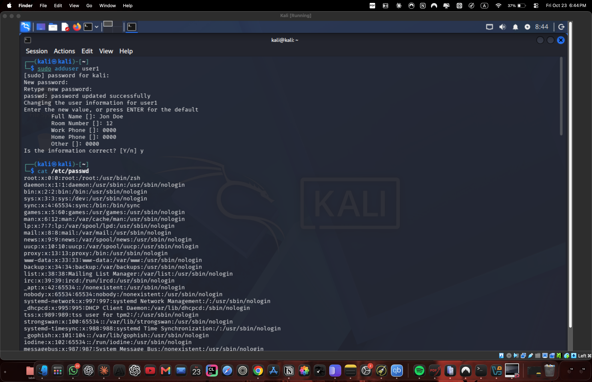
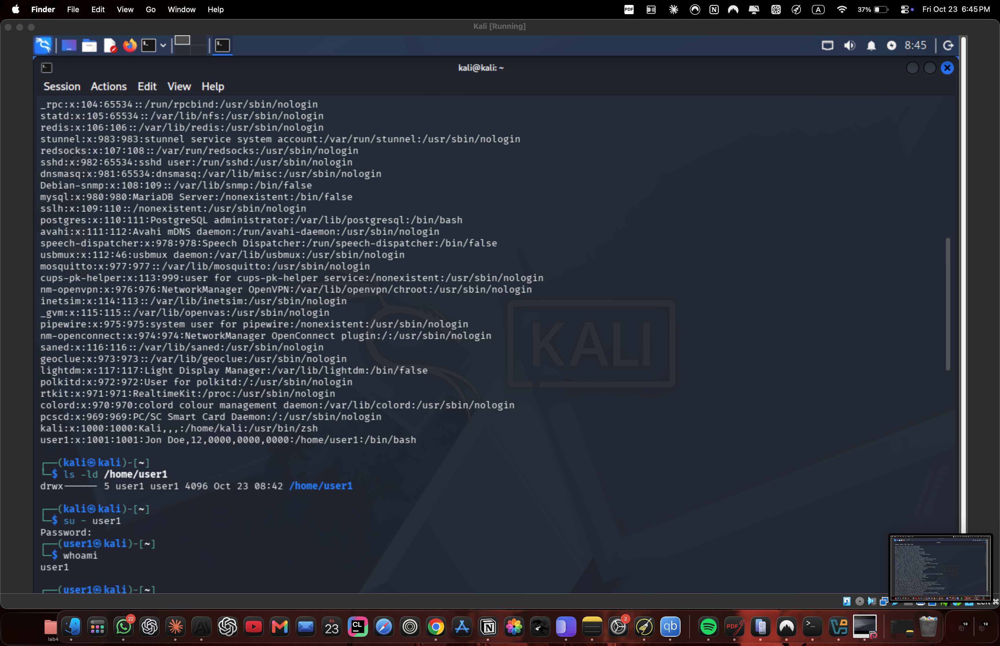
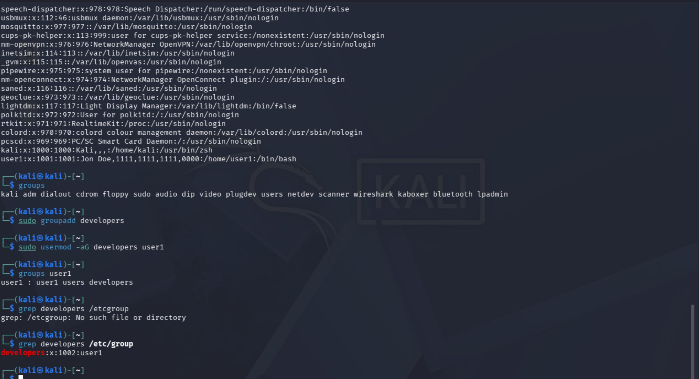
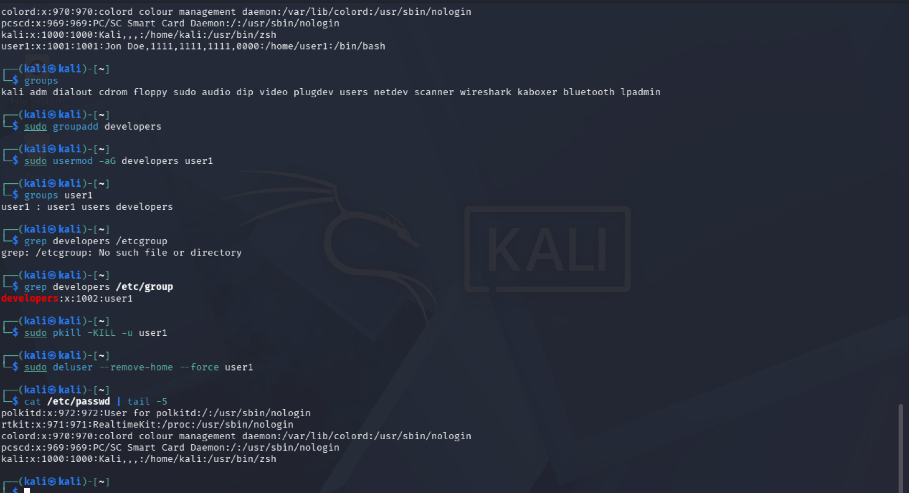

# Lab 5. User Management in Linux

- **Course:** COM-424.1 Information Security, AUCA
- **Student:** Imran Sahak
- **Environment:** Linux VM (Ubuntu/Debian) in VirtualBox

> **Why a VM?** These commands (`adduser`, `deluser`, `su`, `chfn`) manage real
> Linux system accounts and read `/etc/passwd`, `/etc/shadow` and `/etc/group`.
> macOS manages users through a different system (`dscl` / Directory Services) and
> has no `adduser`/`deluser`, so this lab is done inside a Linux VM.

## Goal

Create, inspect, modify and delete a Linux user account, understand the files that
store user and group data, and (the task) create a user and add them to a new group.

## Background: where Linux keeps user data

| File | What it stores |
|------|----------------|
| `/etc/passwd` | One line per user: name, UID, GID, comment, home dir, login shell |
| `/etc/shadow` | Encrypted passwords and password-aging settings (root-only) |
| `/etc/group` | Group names, GIDs, and the members of each group |

A line in `/etc/passwd` such as `user1:x:1001:1001:,,,:/home/user1:/bin/bash` means:

| Field | Value | Meaning |
|-------|-------|---------|
| 1 | `user1` | username |
| 2 | `x` | password is stored (encrypted) in `/etc/shadow`, not here |
| 3 | `1001` | UID (user ID) |
| 4 | `1001` | GID (primary group ID) |
| 5 | `,,,` | GECOS comment (full name, phone, etc. — empty here) |
| 6 | `/home/user1` | home directory |
| 7 | `/bin/bash` | login shell |

---

## Part 1. Create, inspect and delete a user

### 1. Create a new user

```bash
sudo adduser user1
```

`adduser` prompts for a password (twice) and optional personal info. It creates the
account, a matching group, and the home directory `/home/user1` (copied from
`/etc/skel`).

### 2. Verify the user was created

```bash
cat /etc/passwd
```

The last line is the new user:
```
user1:x:1001:1001:user1,,,:/home/user1:/bin/bash
```
And the home directory exists:
```bash
ls -ld /home/user1
```

### 3. Log in as the new user

```bash
su - user1
```

`su - user1` switches to `user1` with a fresh login shell (the `-` loads their
environment). It asks for `user1`'s password.

### 4. Confirm who you are

```bash
whoami        # prints: user1
```

### 5. Change the user's personal information

```bash
chfn
```

`chfn` (change finger info) asks for the password, then lets you set the full name,
room, phone, etc. These go into the GECOS field (field 5 of `/etc/passwd`).

Type `exit` to return to your own account before deleting the user.

### 6. Verify the new info

```bash
cat /etc/passwd
```
The last line now includes the details you typed, e.g.
`user1:x:1001:1001:Imran Sahak,,,:/home/user1:/bin/bash`.

### 7. Kill the user's running sessions

```bash
sudo pkill -KILL -u user1
```

A user cannot be deleted while they are logged in or have running processes.
`pkill -KILL -u user1` ends every process owned by `user1`.

### 8. Delete the user

```bash
sudo deluser --remove-home --force user1
```

`--remove-home` also deletes `/home/user1`, so nothing is left behind.

### 9. Verify deletion

```bash
cat /etc/passwd        # user1 is no longer listed
```

---

## Part 2. Task — groups: create a user and add them to a new group

### a) Discover existing groups

```bash
cat /etc/group                 # full list
cut -d: -f1 /etc/group         # just the group names
groups                         # the groups YOUR account belongs to
```

Common system groups include `sudo` (can use sudo), `adm` (read logs), and
`users` (normal users).

### b) Create a user and a new group, then join them

```bash
# create the user (if not already created above)
sudo adduser user1

# create a new group
sudo groupadd developers

# add user1 to the new group (-a = add, -G = supplementary group)
sudo usermod -aG developers user1

# verify
groups user1
```

**Expected output:**
```
user1 : user1 users developers
```

The matching line in `/etc/group`:
```bash
grep developers /etc/group
# developers:x:1002:user1
```

> **Important:** always use `usermod -aG` (with `-a`). Using `-G` **without** `-a`
> *replaces* all of the user's supplementary groups instead of adding to them,
> which can accidentally remove a user from `sudo` and lock them out.

### c) Clean up (optional)

```bash
sudo deluser --remove-home --force user1
sudo groupdel developers
```

---

## Commands used

| Command | Purpose |
|---------|---------|
| `adduser` / `useradd` | Create a user account |
| `deluser` / `userdel` | Delete a user account |
| `usermod` | Modify a user (here: add to a group) |
| `groupadd` / `groupdel` | Create / delete a group |
| `groups` | Show a user's groups |
| `chfn` | Change a user's personal (GECOS) info |
| `su -` | Switch to another user with a login shell |
| `passwd` | Change a password |
| `pkill -KILL -u` | Kill all of a user's processes |
| `who` / `w` | Show logged-in users |

## Security notes

- `/etc/shadow` holds the hashed passwords and is readable only by root, so normal
  users cannot see password hashes even though `/etc/passwd` is world-readable.
- Group membership is how Linux grants privileges. Being in the `sudo` group means
  a user can act as root, so adding users to groups must be done carefully.
- The `usermod -G` without `-a` mistake is a classic way to accidentally lock
  yourself out of `sudo` — a real operational-security hazard.

## Conclusion

In this lab I managed Linux user accounts: creating a user with `adduser`,
inspecting the `/etc/passwd` entry field by field, logging in with `su -`, editing
personal info with `chfn`, and deleting the user cleanly after killing their
sessions. For the task I listed existing groups, created a `developers` group, and
added the user to it with `usermod -aG`. I learned where Linux stores user and
group data, why `/etc/shadow` is protected, and why the `-a` flag matters when
changing group membership.

## Screenshots

Create the user and set personal info with `chfn`:



Log in as the user, verify with `whoami`, and see the home directory:



The task — list groups, create `developers`, add the user to it:



Kill the session and delete the user:


