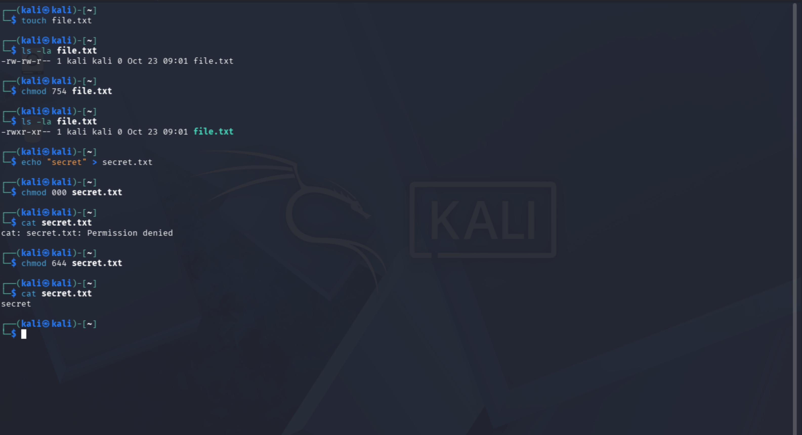
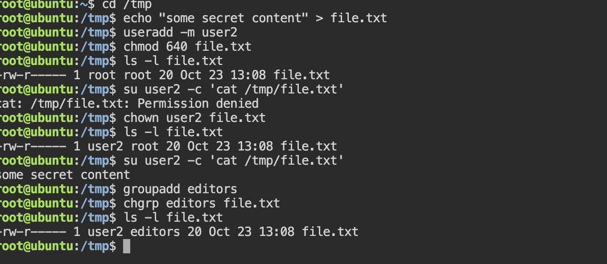

# Lab 6. Permissions in Linux

- **Course:** COM-424.1 Information Security, AUCA
- **Student:** Imran Sahak
- **Environment:** Part 1 in a Linux VM (Kali); Part 2 in an online Ubuntu 24.04 playground (Killercoda), where the shell is already `root`

## Goal

Understand how Linux file permissions work, read and change them with `chmod`
(numeric notation), and — for the task — change a file's owner and group with
`chown` / `chgrp` and see how that changes who can use the file.

## Background: how permissions are shown

`ls -la` shows a 10-character permission string such as `-rw-r--r--`:

```
-   rw-     r--     r--
│    │       │       └── others  (everyone else)
│    │       └────────── group   (members of the file's group)
│    └────────────────── owner   (the user who owns the file)
└─────────────────────── type    (- file, d directory, l symlink)
```

Each group of three is **r**ead, **w**rite, **x**ecute. For files: read = view
contents, write = change contents, execute = run as a program. For directories:
read = list contents, write = create/delete files inside, execute = enter (`cd`)
the directory.

### Numeric (octal) notation

Each permission is a number: **r = 4, w = 2, x = 1**. Add them per group:

| Symbolic | Sum | Digit |
|----------|-----|-------|
| `rwx` | 4+2+1 | 7 |
| `rw-` | 4+2 | 6 |
| `r-x` | 4+1 | 5 |
| `r--` | 4 | 4 |

So `chmod 754` = owner `rwx` (7), group `r-x` (5), others `r--` (4).

---

## Part 1. Viewing and changing permissions

### 1. Create a file and view its permissions

```bash
touch file.txt
ls -la file.txt
```

**Output:**
```
-rw-r--r-- 1 kali kali 0 Oct 23 19:00 file.txt
```

A new file gets `644` (`rw-r--r--`) by default: the owner can read and write,
everyone else can only read.

### 2. Change permissions with numeric notation

```bash
chmod 754 file.txt
ls -la file.txt
```

**Output:**
```
-rwxr-xr-- 1 kali kali 0 Oct 23 19:00 file.txt
```

Now owner = `rwx`, group = `r-x`, others = `r--`.

### 3. "Permission denied" in action

Permissions are enforced even against the file's own owner:

```bash
echo "secret" > secret.txt
chmod 000 secret.txt      # nobody can read/write/execute
cat secret.txt            # -> Permission denied (even though you own it)
chmod 644 secret.txt      # restore read/write for owner
cat secret.txt            # -> secret
```

This shows that access is decided by the permission bits, not by who created the file.

---

## Part 2. Task — change owner and group (`chown` / `chgrp`)

Ownership decides *which* set of permission bits applies to a given user. To show
the effect, we use a second user, `user2`. (In the playground the shell is already
`root`, so no `sudo` is needed; on a normal system, prefix each admin command with
`sudo`.)

```bash
cd /tmp
echo "some secret content" > file.txt
useradd -m user2
```

### a) Before changing owner — user2 is "others", and is blocked

```bash
chmod 640 file.txt                 # owner rw, group r, others nothing
ls -l file.txt
su user2 -c 'cat /tmp/file.txt'
```
**Output:**
```
-rw-r----- 1 root root 20 Oct 23 13:08 file.txt
cat: /tmp/file.txt: Permission denied
```
`user2` is neither the owner nor in the group, so the `others` bits (`---`) apply
and the read is refused.

### b) Change the owner with `chown` — now user2 can read

```bash
chown user2 file.txt
ls -l file.txt
su user2 -c 'cat /tmp/file.txt'
```
**Output:**
```
-rw-r----- 1 user2 root 20 Oct 23 13:08 file.txt
some secret content
```
Nothing about the permission bits changed — only the **owner**. Because `user2`
is now the owner, the owner bits (`rw-`) apply to them, so the read succeeds. This
is the key point: `chown` changes *which* permission set a user falls under.

### c) Change the group with `chgrp`

```bash
groupadd editors
chgrp editors file.txt
ls -l file.txt                     # group is now 'editors'
```
**Output:**
```
-rw-r----- 1 user2 editors 20 Oct 23 13:08 file.txt
```

You can also set owner and group together: `chown user:group file.txt`.

### Cleanup

```bash
userdel -r user2
groupdel editors
```

---

## Commands used

| Command | Purpose |
|---------|---------|
| `ls -la` | Show permissions, owner, group, size, date |
| `chmod` | Change permissions (numeric or symbolic) |
| `chown` | Change the owner (and optionally group: `chown user:group`) |
| `chgrp` | Change the group |
| `touch` | Create an empty file |

## Security notes

- Permissions are the core of Linux access control. `chmod 777` (everyone can do
  everything) is dangerous and should be avoided, as noted back in Lab 1.
- Only root (or the current owner, for some operations) can change ownership, which
  is why `chown`/`chgrp` need `sudo`. If a normal user could give away or take file
  ownership freely, access control would be meaningless.
- `chown` affecting access is the basis of privilege separation: services run as
  their own users (e.g. `www-data`) so a web server can only touch files it owns,
  limiting the damage if it is compromised.

## Conclusion

In this lab I read the Linux permission string field by field, changed permissions
with numeric notation (`chmod 754`), and confirmed that access is enforced even
against a file's owner (`chmod 000` → Permission denied). For the task I used
`chown` and `chgrp` to change a file's owner and group, and showed that changing
the owner changes which permission set applies to a user: `user2` went from
"Permission denied" to being able to read the file without any change to the bits
themselves. This demonstrates how ownership and permissions together control file
access in Linux.

## Screenshots

Viewing and changing permissions, including a Permission-denied demo:



Changing owner and group, and the effect on access:


