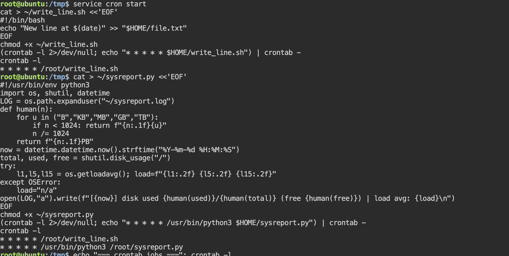
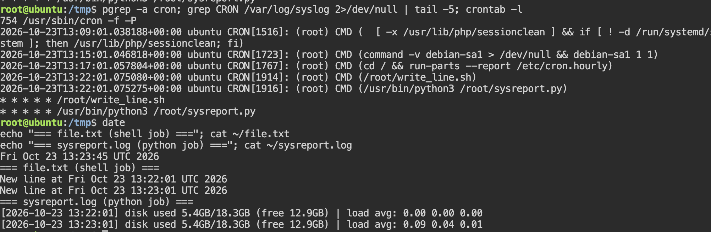

# Lab 7. Crontab in Linux

- **Course:** COM-424.1 Information Security, AUCA
- **Student:** Imran Sahak
- **Environment:** Linux (Kali VM / Ubuntu playground)

## Goal

Learn how to schedule automatic tasks with **cron**, by running a shell script
every minute, and (the task) scheduling a **Python** script that does real work.

## Files

| File | Description |
|------|-------------|
| [`write_line.sh`](write_line.sh) | Appends a timestamped line to a file (Part 1 example) |
| [`sysreport.py`](sysreport.py) | Appends a timestamped system-health report — the task, no credentials needed |
| [`notify_owner.py`](notify_owner.py) | Alternative task: email a status note to the server owner, credentials from environment variables |

## Background: the crontab format

Each cron line is five time fields followed by the command:

```
* * * * * command_to_run
│ │ │ │ │
│ │ │ │ └─ day of week (0-6, Sunday = 0)
│ │ │ └─── month (1-12)
│ │ └───── day of month (1-31)
│ └─────── hour (0-23)
└───────── minute (0-59)
```

`* * * * *` means "every minute". Examples: `30 2 * * *` = 02:30 daily;
`0 * * * *` = top of every hour; `0 9 * * 1` = 09:00 every Monday.

**Commands:** `crontab -e` edit, `crontab -l` list, `crontab -r` remove.
**Special strings:** `@reboot`, `@hourly`, `@daily`, `@weekly`, `@monthly`, `@yearly`.

> **Note:** cron must be running for jobs to fire. On a minimal system start it with
> `sudo service cron start` (or `service cron start` if you are already root).
> Also, the lab writes to `/home`, which normal users cannot write to, so I used the
> home directory `$HOME` instead.

---

## Part 1. Example — run a shell script every minute

### 1–3. Create the script and make it executable

`write_line.sh`:
```bash
#!/bin/bash
# write_line.sh - append the current date/time to a log file
echo "New line at $(date)" >> "$HOME/file.txt"
```
```bash
chmod +x ~/write_line.sh
```

### 4. Schedule it with cron

Open the crontab:
```bash
crontab -e
```
and add this line (every minute), then save:
```
* * * * * /root/write_line.sh
```

> Instead of the interactive editor you can add the job in one line:
> ```bash
> (crontab -l 2>/dev/null; echo "* * * * * $HOME/write_line.sh") | crontab -
> ```

### 5. Check it works

Wait a couple of minutes, then:
```bash
crontab -l          # shows the scheduled job
cat ~/file.txt      # a new line was added each minute
```
**Output** (a new line appears every minute):
```
New line at Fri Oct 23 19:16:18 ...
New line at Fri Oct 23 19:17:18 ...
New line at Fri Oct 23 19:18:18 ...
```

---

## Part 2. Task — schedule a Python script

The task is to run a Python script on a schedule. I did this two ways.

### Version A (main): a system-health report — `sysreport.py`

This needs no credentials, so it is easy to test. Each run appends a timestamped
line with disk usage and system load.

```python
#!/usr/bin/env python3
import os, shutil, datetime

LOG = os.path.expanduser("~/sysreport.log")

def human(n):
    for unit in ("B", "KB", "MB", "GB", "TB"):
        if n < 1024:
            return f"{n:.1f}{unit}"
        n /= 1024
    return f"{n:.1f}PB"

def main():
    now = datetime.datetime.now().strftime("%Y-%m-%d %H:%M:%S")
    total, used, free = shutil.disk_usage("/")
    try:
        l1, l5, l15 = os.getloadavg()
        load = f"{l1:.2f} {l5:.2f} {l15:.2f}"
    except OSError:
        load = "n/a"
    line = (f"[{now}] disk used {human(used)}/{human(total)} "
            f"(free {human(free)}) | load avg: {load}\n")
    with open(LOG, "a") as f:
        f.write(line)
    print(line, end="")

if __name__ == "__main__":
    main()
```

Schedule it every minute:
```bash
chmod +x ~/sysreport.py
(crontab -l 2>/dev/null; echo "* * * * * /usr/bin/python3 $HOME/sysreport.py") | crontab -
```
Wait two minutes, then:
```bash
cat ~/sysreport.log
```
**Output:**
```
[2026-10-23 19:16:18] disk used 13.4GB/252.0GB (free 29.9GB) | load avg: 0.10 0.03 0.01
[2026-10-23 19:17:18] disk used 13.4GB/252.0GB (free 29.9GB) | load avg: 0.08 0.03 0.01
```

> **Tip:** cron runs with a minimal PATH, so always use the **full path** to the
> interpreter (`/usr/bin/python3`) and to the script in the crontab line. A job that
> works by hand but silently fails under cron is almost always a PATH problem.

### Version B (matches the lab's example): email the owner — `notify_owner.py`

This sends a status email to the server owner (you). The key difference from a
phishing script is that it notifies the *owner* and reads its credentials from
**environment variables**, so no password is ever written into the file:

```python
#!/usr/bin/env python3
import os, smtplib, ssl, datetime
from email.message import EmailMessage

SMTP_SERVER, SMTP_PORT = "smtp.gmail.com", 587

def main():
    user = os.environ.get("SMTP_USER")
    password = os.environ.get("SMTP_PASS")
    owner = os.environ.get("OWNER_EMAIL", user)
    if not user or not password:
        raise SystemExit("Set SMTP_USER and SMTP_PASS environment variables first.")
    now = datetime.datetime.now().strftime("%Y-%m-%d %H:%M:%S")
    msg = EmailMessage()
    msg["From"], msg["To"] = user, owner
    msg["Subject"] = f"Server status report - {now}"
    msg.set_content(f"Automated check-in from your server at {now}. All running.")
    with smtplib.SMTP(SMTP_SERVER, SMTP_PORT) as server:
        server.starttls(context=ssl.create_default_context())
        server.login(user, password)
        server.send_message(msg)
    print(f"Status email sent to {owner} at {now}")

if __name__ == "__main__":
    main()
```

To use it, set the variables (a Gmail **App Password**, not your login password)
and schedule it, e.g. once a day at 09:00:
```bash
export SMTP_USER="you@gmail.com"
export SMTP_PASS="your_app_password"
(crontab -l 2>/dev/null; echo "0 9 * * * SMTP_USER=you@gmail.com SMTP_PASS=xxxx /usr/bin/python3 $HOME/notify_owner.py") | crontab -
```

---

## Commands used

| Command | Purpose |
|---------|---------|
| `crontab -e` / `-l` / `-r` | edit / list / remove the user's cron jobs |
| `service cron start` | start the cron daemon |
| `chmod +x` | make a script executable |
| `date` | current date/time (used in the shell script) |

## Security notes

- **Credentials never belong in source.** The lab's original example hard-codes a
  Gmail password in the script; anyone who reads the file (or the Git history) then
  has the account. `notify_owner.py` reads them from environment variables instead.
- Cron jobs run **unattended with your privileges**, so a malicious or compromised
  script in your crontab runs automatically and repeatedly. Attackers often add a
  `@reboot` or `* * * * *` cron entry for **persistence** — surviving reboots and
  re-establishing access. Checking `crontab -l` (and `/etc/cron*`) is a standard
  step when investigating a compromised machine.
- Always schedule scripts with **full paths**, because cron's minimal environment is
  a common source of silent failures.

## Conclusion

In this lab I scheduled automatic tasks with cron: first a shell script that
appended a timestamp to a file every minute, then a Python script as the task. I
wrote a credential-free system-report script that logs disk and load each run, and
an email-notification version that reads its credentials from environment variables
rather than hard-coding them. I learned the five-field cron format, that cron needs
full paths because of its minimal environment, and that cron is commonly abused for
persistence — so `crontab -l` is a useful thing to check on a suspect system.

## Screenshots

Setting up both cron jobs — creating the scripts and scheduling them with
`crontab` (shown via `crontab -l`):



Proof the jobs ran: the syslog shows cron executing `write_line.sh` and
`sysreport.py` each minute, and both logs fill with timestamped lines a minute
apart:


