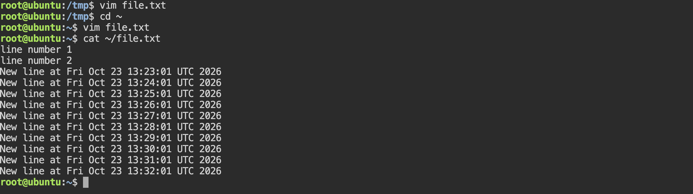

# Lab 8. Vim Editor

- **Course:** COM-424.1 Information Security, AUCA
- **Student:** Imran Sahak
- **Environment:** Linux (Kali VM / Ubuntu playground)

## Goal

Learn the basics of the Vim text editor — its modes and the core commands for
editing, deleting, saving and quitting — then (the task) explore a wider set of
Vim commands.

## Vim's modes

Vim is *modal*: the same keys do different things depending on the mode. This is
what confuses beginners, but it is also what makes Vim fast.

| Mode | How to enter | What it is for |
|------|--------------|----------------|
| **Normal** | `Esc` (the default) | Navigation and commands (`dd`, `yy`, `x`, …) |
| **Insert** | `i`, `a`, `o` | Typing text |
| **Visual** | `v`, `V`, `Ctrl+v` | Selecting text |
| **Command-line** | `:` (from Normal) | Running commands (`:w`, `:q`, `:%d`, …) |

The golden rule: when in doubt, press **`Esc`** to get back to Normal mode.

---

## Part 1. Basic Vim session

### 1–3. Install, create and open a file

```bash
sudo apt install vim      # if not already installed
touch file.txt
vim file.txt
```

### 4. Type some text

Press `i` to enter **Insert** mode, then type:
```
some text
more text
even more text
```

### 5–6. Delete a line with `dd`

Press `Esc` to return to Normal mode, move the cursor to a line, and press
`d` twice (`dd`). The whole line is deleted.

### 7–8. Delete everything with `:%d`

- Press `i` to type again if you want.
- Press `Esc`, then type `:%d` and Enter — this deletes **all** lines in the file
  (`%` = the whole file, `d` = delete).

### 9. Save with `:w`

Press `Esc`, type `:w` and Enter. Vim shows a message like
`"file.txt" 3L, 30B written` confirming the file was saved.

### 10. Quit

- `:q` — quit (only works if there are no unsaved changes)
- `:q!` — quit **without** saving (discard changes)
- `:wq` (or `:x`, or `ZZ`) — save **and** quit in one step

---

## Part 2. Task — more Vim commands

I explored the wider command set. Here is a cheat sheet of the most useful ones.

### Moving around (Normal mode)

| Key | Moves to |
|-----|----------|
| `h` `j` `k` `l` | left, down, up, right |
| `w` / `b` | next / previous word |
| `0` / `$` | start / end of line |
| `gg` / `G` | first / last line of file |
| `:n` | go to line number *n* (e.g. `:10`) |
| `Ctrl+f` / `Ctrl+b` | page down / up |

### Entering Insert mode

| Key | Effect |
|-----|--------|
| `i` / `a` | insert before / after the cursor |
| `I` / `A` | insert at start / end of the line |
| `o` / `O` | open a new line below / above |

### Editing and deleting

| Command | Effect |
|---------|--------|
| `x` | delete the character under the cursor |
| `dd` | delete (cut) the current line |
| `dw` | delete to the end of the word |
| `yy` | yank (copy) the current line |
| `p` / `P` | paste after / before the cursor |
| `u` | undo |
| `Ctrl+r` | redo |
| `r<char>` | replace a single character |
| `cc` | change (replace) the whole line |

### Searching and replacing

| Command | Effect |
|---------|--------|
| `/text` | search forward for *text* |
| `?text` | search backward |
| `n` / `N` | next / previous match |
| `:%s/old/new/g` | replace *old* with *new* everywhere in the file |
| `:%s/old/new/gc` | same, but ask for confirmation each time |

### Visual mode (selecting)

| Key | Effect |
|-----|--------|
| `v` | character-wise selection |
| `V` | line-wise selection |
| `Ctrl+v` | block (column) selection |
| `y` / `d` | yank / delete the selection |

### Saving and quitting

| Command | Effect |
|---------|--------|
| `:w` | save |
| `:w filename` | save as a new name |
| `:q` | quit |
| `:q!` | quit without saving |
| `:wq` / `:x` / `ZZ` | save and quit |

### Other useful bits

| Command | Effect |
|---------|--------|
| `:set number` | show line numbers |
| `:set nonumber` | hide line numbers |
| `:syntax on` | turn on syntax highlighting |
| `.` | repeat the last change |
| `:help <topic>` | open Vim's built-in help |

These can be made permanent in a `~/.vimrc` file, e.g.:
```
set number
syntax on
set tabstop=4
```

---

## Why Vim matters for security

- Vim (or at least `vi`) is **pre-installed on almost every Unix system**, including
  minimal servers and rescue environments where no graphical editor exists. When you
  SSH into a remote machine to edit a config file — `/etc/ssh/sshd_config`,
  `/etc/hosts`, a firewall rule — Vim is often the only editor available.
- Being comfortable in Vim means you can work on a compromised or locked-down box
  that has nothing else, which is a routine situation in system administration and
  incident response.
- `:q!` (quit without saving) is an important safety command: if you open a critical
  system file by mistake, it lets you leave without changing anything.

## Conclusion

In this lab I learned Vim's modal design and the core workflow: `i` to insert text,
`Esc` to return to Normal mode, `dd` to delete a line, `:%d` to clear the file, and
`:w` / `:wq` / `:q!` to save and quit. For the task I built a cheat sheet covering
navigation (`gg`, `G`, `w`, `$`), editing (`x`, `yy`, `p`, `u`), search-and-replace
(`:%s/old/new/g`), visual mode, and `~/.vimrc` customization. Vim is worth knowing
because it is available on essentially every Unix system, which makes it the default
tool for editing files on remote and minimal servers.

## Screenshots

Editing text in Vim (text entered in Insert mode):


Confirming the file was saved with `:wq`, by reading it back with `cat`:


