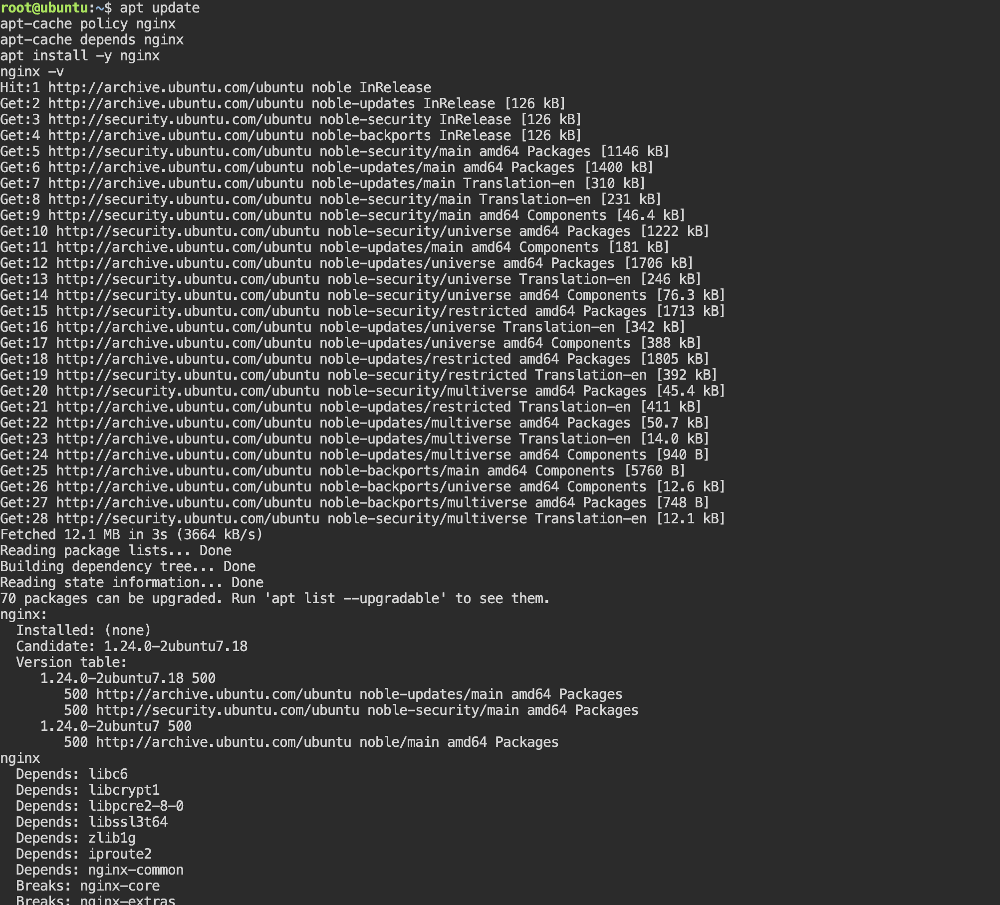
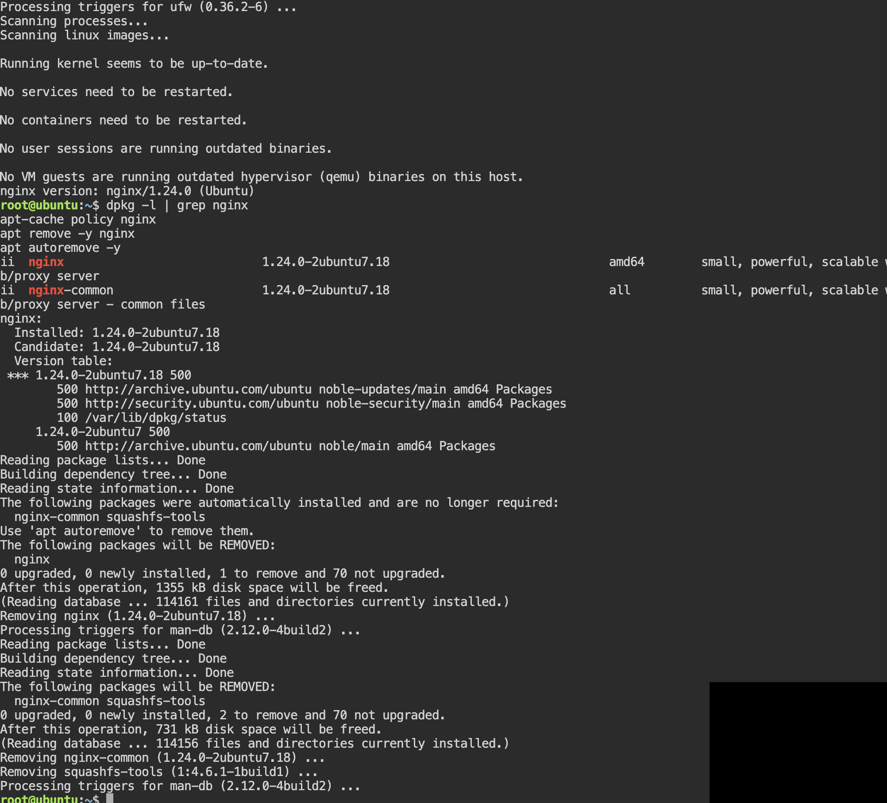

# Lab 9. Package Management

- **Course:** COM-424.1 Information Security, AUCA
- **Student:** Imran Sahak
- **Environment:** Linux (Ubuntu 24.04 playground / Kali VM), APT package manager

## Goal

Learn how software is managed on Debian-based Linux with **APT**, and (the task)
install and explore the **nginx** package using the standard commands.

## Background

A **package** bundles a program's binaries, libraries, config files and metadata
(version, description, dependencies) so the system can install, update or remove it
cleanly. Common formats:

| Format | Systems |
|--------|---------|
| `.deb` | Debian / Ubuntu (APT) |
| `.rpm` | Red Hat / Fedora / CentOS |
| `.tar.gz`, `.tar.bz2` | source code / manual builds |

**APT** (Advanced Package Tool) installs `.deb` packages from configured
repositories (listed in `/etc/apt/sources.list`) and automatically resolves
dependencies.

| Command | What it does |
|---------|--------------|
| `apt update` | refresh the list of available packages (installs nothing) |
| `apt upgrade` | upgrade installed packages to their latest versions |
| `apt install <pkg>` | install a package and its dependencies |
| `apt remove <pkg>` | remove a package (keeps its config files) |
| `apt purge <pkg>` | remove a package **and** its config files |
| `apt search <pkg>` | search the repositories for a package |
| `apt-cache depends <pkg>` | list a package's dependencies |

> On these systems the shell is already `root`, so `sudo` is optional. On a normal
> machine, prefix the admin commands with `sudo`.

---

## Task — install and explore nginx

nginx is a popular web server. Here is the full lifecycle: look it up, install it,
verify it, inspect its dependencies, then remove it.

### 1. Update the package list

```bash
apt update
```
This refreshes what APT knows about; it does not install anything.

### 2. Search for the package and check its details

```bash
apt search nginx          # list matching packages
apt-cache policy nginx    # show installed vs. available version
```
**Output of `apt-cache policy nginx`** (before installing):
```
nginx:
  Installed: (none)
  Candidate: 1.24.0-2ubuntu7.18
  Version table:
     1.24.0-2ubuntu7.18 500
        500 http://archive.ubuntu.com/ubuntu noble-updates/main amd64 Packages
```
`Installed: (none)` means it is not yet installed; `Candidate` is the version APT
would install.

### 3. Inspect the dependencies

```bash
apt-cache depends nginx
```
**Output:**
```
nginx
  Depends: libc6
  Depends: libcrypt1
  Depends: libpcre2-8-0
  Depends: libssl3t64
  Depends: zlib1g
  Depends: iproute2
  Depends: nginx-common
  ...
```
These are the libraries and helper packages APT will pull in automatically — for
example `libssl3` (TLS/HTTPS) and `libpcre2` (regular expressions for URL rules).

### 4. Install it

```bash
apt install -y nginx
```
APT downloads nginx and all the dependencies above, then configures them. Verify:

```bash
nginx -v                  # prints the version, e.g. nginx/1.24.0
dpkg -l | grep nginx      # shows the installed nginx packages
```

### 5. Confirm it is now installed

```bash
apt-cache policy nginx
```
This time `Installed:` shows the version number instead of `(none)`.

### 6. Remove it

```bash
apt remove -y nginx       # removes nginx, keeps config files
# or, to also delete the config files:
apt purge -y nginx
apt autoremove -y         # remove dependencies no longer needed
```

---

## Security notes

- **Only install from trusted repositories.** APT verifies packages with
  cryptographic signatures (GPG keys) so a tampered or fake package is rejected.
  Adding random third-party repositories or installing a downloaded `.deb` with
  `dpkg -i` bypasses that trust and is a common way malware gets onto a system.
- **Keep packages updated.** `apt update && apt upgrade` applies security patches;
  unpatched packages are one of the most common ways systems get compromised.
- **Remove what you don't need.** Every installed package is extra attack surface.
  `apt purge` + `apt autoremove` keep a system minimal, which is a basic hardening
  step — a web server should not also have compilers and random tools lying around.
- Running a service like nginx means a process is now listening on the network
  (port 80), so installing software can directly change a machine's exposure.

## Conclusion

In this lab I learned how APT manages software on Debian-based Linux: `apt update`
refreshes the package list, `apt install`/`remove`/`purge` manage packages, and
`apt search` / `apt-cache depends` inspect them. For the task I went through the full
lifecycle of the nginx package — checking its candidate version, listing its
dependencies (libssl, libpcre, nginx-common, …), installing it, verifying with
`nginx -v`, and removing it. I also learned that APT's signature checking is what
makes installing from official repositories safe, and that keeping packages patched
and minimal is a basic part of securing a system.

## Screenshots

Exploring nginx — version, dependencies, and installation:



Verifying and removing the package:


